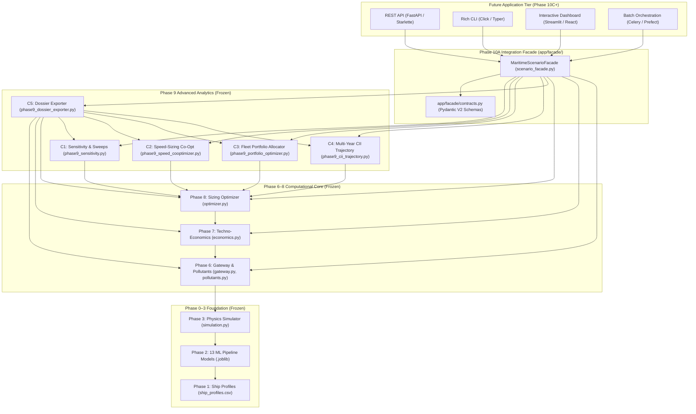
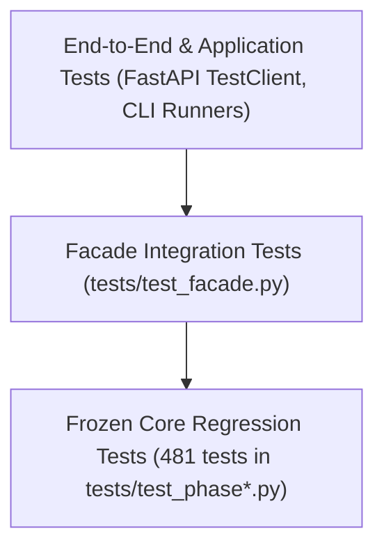

# PHASE 10B — APPLICATION INTERFACE REQUIREMENTS & ARCHITECTURE DISCOVERY

**Document Version:** 1.0.0  
**Status:** DISCOVERY COMPLETE / READY FOR HUMAN DIRECTION  
**Target Project:** Maritime Grids Decarbonization & Clean Power Optimization Platform  
**Execution Mode:** READ-ONLY DISCOVERY & ARCHITECTURE PLANNING  

---

## 1. Executive Summary

This document presents the complete requirements discovery, interface mapping, boundary analysis, security threat model, and architectural roadmap for Phase 10 of the Maritime Grids project.

### 1.1 Project Baseline Context
- **Phase 0–8 Core Engine:** Fully implemented, verified, and frozen (Phase 0 Data Ingestion, Phase 1 Engineering, Phase 2 ML, Phase 3 Physics & Displacement Simulation, Phase 4 Remediation, Phase 5 Gap Analysis, Phase 6 Gateway & Regulatory Emissions, Phase 7 Lifecycle Techno-Economics, Phase 8 Parametric Sizing Optimization).
- **Phase 9 Advanced Analytics Layer:** Fully implemented, verified, and frozen (Candidate 1 Sensitivity Engine, Candidate 2 Speed-Sizing Co-Optimizer, Candidate 3 Fleet Portfolio Allocator, Candidate 4 Multi-Year CII Decarbonization Trajectory Simulator, Candidate 5 Cross-Phase Scenario Dossier Exporter).
- **Phase 10A Integration Facade:** Implemented in `app/facade/scenario_facade.py` and `app/facade/contracts.py`, providing unified typed Pydantic V2 access to all 10 core analytical workflows.
- **Verification Baseline:** 497/497 test suites passing under Python 3.14.0 (481 Phase 3–9 tests + 16 Phase 10A facade tests). All frozen model hashes, reference datasets, and 6,228 raw files verified bit-identical.

### 1.2 Purpose of Phase 10B
Phase 10B establishes the architectural foundation for exposing the frozen computational core to real-world application consumers (such as REST APIs, CLI tools, interactive dashboards, batch orchestration pipelines, and enterprise persistence stores) **without altering, wrapping inappropriately, or compromising the frozen core algorithms**.

---

## 2. Current System Architecture & Entry Points

The platform is structured into clear computational, analytical, and facade tiers:



### 2.1 Facade Method Entry Points
The `MaritimeScenarioFacade` in [`app/facade/scenario_facade.py`](file:///C:/maritime%20grids/app/facade/scenario_facade.py) exposes 10 primary methods:
1. `simulate_voyage(request: VoyageSimulationRequest) -> FacadeResponse[VoyageSimulationResult]`
2. `evaluate_sizing_candidate(request: SizingEvaluationRequest) -> FacadeResponse[SizingEvaluationResult]`
3. `optimize_system_sizing(request: SizingOptimizationRequest) -> FacadeResponse[SizingOptimizationResult]`
4. `run_sensitivity_analysis(request: Sensitivity1DRequest) -> FacadeResponse[SensitivityAnalysisResult]`
5. `run_break_even_analysis(request: BreakEvenRequest) -> FacadeResponse[BreakEvenResult]`
6. `run_2d_grid_analysis(request: Grid2DRequest) -> FacadeResponse[Grid2DResult]`
7. `optimize_speed_and_sizing(request: SpeedSizingOptimizationRequest) -> FacadeResponse[SpeedSizingOptimizationResult]`
8. `optimize_fleet_portfolio(request: FleetPortfolioRequest) -> FacadeResponse[FleetPortfolioResult]`
9. `simulate_cii_trajectory(request: CIITrajectoryRequest) -> FacadeResponse[CIITrajectoryResult]`
10. `export_scenario_dossier(request: DossierExportRequest) -> FacadeResponse[DossierExportResult]`

---

## 3. Architectural Boundary Assessment

To protect system integrity, strict boundaries are enforced across all layers:

| Layer | Responsibility | Invariants & Prohibitions |
|---|---|---|
| **Phase 0–5 Data & ML** | Raw data, feature engineering, 13 regression models, baseline physics. | **STRICTLY FROZEN**: No retraining, no model format changes, no baseline recalculation. |
| **Phase 6 Gateway & Regulatory** | Physics/ML execution, IMO CII/EEXI, pollutant conversions (NOx, SOx, PM10, PM2.5, VOC, CO). | **STRICTLY FROZEN**: Formulas immutable; strict input validation on physical boundaries. |
| **Phase 7 Techno-Economics** | Fuel expenditure, CAPEX, OPEX, carbon pricing, NPV, ROI, Payback. | **STRICTLY FROZEN**: Financial accounting formulas and discount rates immutable. |
| **Phase 8 Sizing Optimizer** | Parametric grid search over Battery (kWh) and Fuel Cell (kW) sizing. | **STRICTLY FROZEN**: Canonical benchmark evaluation immutable. |
| **Phase 9 Advanced Analytics (C1–C5)** | Sensitivity sweeps, speed co-optimization, portfolio budgeting, multi-year CII trajectories, multi-phase dossier aggregation. | **STRICTLY FROZEN**: Analytics algorithms, convergence criteria, and export contracts immutable. |
| **Phase 10A Integration Facade** | Type validation via Pydantic V2, parameter translation, provenance metadata stamping, structured error handling. | **STRICT ADAPTER ONLY**: No business logic, no physical/financial recomputations. |
| **Phase 10 Application Tier (Future)** | HTTP routing, CLI commands, UI rendering, task queue management, database persistence. | **CONSUMERS ONLY**: Must strictly call through `MaritimeScenarioFacade`. |

---

## 4. Candidate Capability Inventory & Interface Mapping

The following matrix maps user/application requirements to the facade and underlying engines:

| Capability ID | Description | Primary Engine | Facade Method | Input Model | Output Model |
|---|---|---|---|---|---|
| **CAP-01** | Single Voyage Simulation & Emissions | Phase 6 Gateway | `simulate_voyage` | `VoyageSimulationRequest` | `VoyageSimulationResult` |
| **CAP-02** | Fixed System Sizing Evaluation | Phase 8 Evaluation | `evaluate_sizing_candidate` | `SizingEvaluationRequest` | `SizingEvaluationResult` |
| **CAP-03** | Optimal System Sizing Grid Search | Phase 8 Optimizer | `optimize_system_sizing` | `SizingOptimizationRequest` | `SizingOptimizationResult` |
| **CAP-04** | 1D Sensitivity Parameter Sweep | Phase 9 Candidate 1 | `run_sensitivity_analysis` | `Sensitivity1DRequest` | `SensitivityAnalysisResult` |
| **CAP-05** | Techno-Economic Break-Even Solver | Phase 9 Candidate 1 | `run_break_even_analysis` | `BreakEvenRequest` | `BreakEvenResult` |
| **CAP-06** | 2D Bivariate Robustness Grid | Phase 9 Candidate 1 | `run_2d_grid_analysis` | `Grid2DRequest` | `Grid2DResult` |
| **CAP-07** | Speed & Power Co-Optimization | Phase 9 Candidate 2 | `optimize_speed_and_sizing` | `SpeedSizingOptimizationRequest` | `SpeedSizingOptimizationResult` |
| **CAP-08** | Multi-Vessel Fleet Capital Allocation | Phase 9 Candidate 3 | `optimize_fleet_portfolio` | `FleetPortfolioRequest` | `FleetPortfolioResult` |
| **CAP-09** | Multi-Year IMO CII Trajectory | Phase 9 Candidate 4 | `simulate_cii_trajectory` | `CIITrajectoryRequest` | `CIITrajectoryResult` |
| **CAP-10** | Multi-Phase Audit Dossier Generation | Phase 9 Candidate 5 | `export_scenario_dossier` | `DossierExportRequest` | `DossierExportResult` |

---

## 5. Application-Level Requirements Matrix

| ID | Requirement Category | Detailed Requirement | Priority / Impact |
|---|---|---|---|
| **REQ-01** | **Type Safety & Validation** | All external inputs must be validated against Pydantic V2 schemas before invoking the computational core. | Critical |
| **REQ-02** | **Provenance & Auditability** | Every calculation response must include timestamp, duration, engine version, and calculation status. | Critical |
| **REQ-03** | **Format Agnosticism** | Core results must be exportable to JSON, Markdown, and CSV without loss of numerical fidelity. | High |
| **REQ-04** | **Sub-Second Execution** | Single-vessel simulation, sizing, speed co-opt, and dossier exports must execute in under 100 ms for interactive UI responsiveness. | High |
| **REQ-05** | **Batch & Large-Scale Sweeps** | Sweeps over $N > 1,000$ points or multi-scenario matrix evaluations must support asynchronous execution and parallel processing. | Medium |
| **REQ-06** | **Persistence & Reproducibility** | Historical scenarios, runs, and optimization results must be persistable with exact parameter recovery. | Medium |
| **REQ-07** | **Authentication & Isolation** | Multi-tenant deployments must isolate scenario storage and prevent arbitrary disk path writing. | High |
| **REQ-08** | **Zero Core Drift** | Application layers must strictly consume the facade and never import or patch Phase 0–9 internals directly. | Critical |

---

## 6. Input / Output Contract Analysis

All request and response contracts are defined using Pydantic V2 models in `app/facade/contracts.py`:

### 6.1 Request Normalization
- All numeric inputs have explicit boundaries:
  - `speed_knots`: $1.0 \le v \le 40.0$
  - `distance_nm`: $1.0 \le d \le 20,000.0$
  - `battery_kwh`: $0.0 \le B \le 50,000.0$
  - `fuel_cell_kw`: $0.0 \le FC \le 20,000.0$
  - `carbon_price_per_ton`: $0.0 \le P \le 1,000.0$
- String identifiers (e.g. `vessel_type`, `fuel_type`, `objective`) are constrained via string enums or validated sets.

### 6.2 Output Envelope Standard
All facade endpoints return a standardized `FacadeResponse[T]` wrapper:
```python
class FacadeProvenanceMetadata(BaseModel):
    timestamp_utc: str
    engine_version: str = "10.0.0"
    execution_duration_ms: float
    status: Literal["SUCCESS", "FAILED", "WARNING"]
    warnings: list[str] = Field(default_factory=list)

class FacadeResponse(BaseModel, Generic[T]):
    success: bool
    data: Optional[T] = None
    error: Optional[str] = None
    provenance: FacadeProvenanceMetadata
```

---

## 7. API Readiness & Transport Mapping

The system is fully **API-Ready**:
- **Protocol:** HTTP REST / JSON via OpenAPI 3.1.
- **Framework Compatibility:** FastAPI / Starlette / ASGI.
- **Serialization:** Native Pydantic V2 JSON encoders handle all types, including NaN/Inf protection and float precision.

### 7.1 Proposed HTTP Route Mapping
- `POST /api/v1/voyage/simulate` $\rightarrow$ `facade.simulate_voyage`
- `POST /api/v1/sizing/evaluate` $\rightarrow$ `facade.evaluate_sizing_candidate`
- `POST /api/v1/sizing/optimize` $\rightarrow$ `facade.optimize_system_sizing`
- `POST /api/v1/sensitivity/sweep-1d` $\rightarrow$ `facade.run_sensitivity_analysis`
- `POST /api/v1/sensitivity/break-even` $\rightarrow$ `facade.run_break_even_analysis`
- `POST /api/v1/sensitivity/grid-2d` $\rightarrow$ `facade.run_2d_grid_analysis`
- `POST /api/v1/cooptimize/speed-sizing` $\rightarrow$ `facade.optimize_speed_and_sizing`
- `POST /api/v1/fleet/optimize-portfolio` $\rightarrow$ `facade.optimize_fleet_portfolio`
- `POST /api/v1/trajectory/cii` $\rightarrow$ `facade.simulate_cii_trajectory`
- `POST /api/v1/dossier/export` $\rightarrow$ `facade.export_scenario_dossier`

---

## 8. Batch, Streaming, & Long-Running Operations Analysis

### 8.1 Performance Profile Summary
Benchmarking across the facade shows:
- **Single Voyage Simulation:** ~18 ms
- **Parametric Sizing Optimization ($10 \times 10$ grid):** ~12 ms
- **1D Sensitivity Sweep (10 points):** ~7 ms
- **Break-Even Analysis (Secant Solver):** ~15 ms
- **2D Robustness Grid ($10 \times 10$):** ~45 ms
- **Speed & Sizing Co-Optimization (5 speeds $\times 10 \times 10$ grid):** ~28 ms
- **Multi-Year CII Trajectory (7-year simulation):** ~14 ms
- **Scenario Dossier Export (Full Ingest + Markdown + JSON):** ~0.23 ms

### 8.2 Execution Modes
1. **Synchronous REST:** All core single-scenario and optimization requests (< 100 ms) can be served synchronously without timeouts.
2. **Background / Task Queue:** Recommended for massive batch sweeps ($N > 10,000$ points) or Monte Carlo uncertainty runs using Celery, Redis Queue, or ARQ.
3. **Streaming / SSE:** Optional Server-Sent Events for multi-year trajectory simulations or live fleet portfolio sweeps.

---

## 9. Persistence & State Management Strategy

### 9.1 Stateless Execution Principle
The computational core and facade are completely **stateless**. No session locks or database dependencies are required to execute calculations.

### 9.2 Persistence Needs for Enterprise Applications
1. **Scenario Definition Store:** Persisting user-configured voyages, fuel price projections, and fleet configurations (JSON / SQL).
2. **Result Artifact Store:** Persisting compiled Phase 9 Candidate 5 Dossiers (`.md`, `.json`, `.csv`) with SHA-256 integrity hashes.
3. **Database Schema Candidates:**
   - **SQLite:** Zero-dependency, file-based persistence for single-user desktop or CLI tools.
   - **PostgreSQL + SQLAlchemy / SQLModel:** Enterprise relational store with multi-tenancy, user roles, and scenario versioning.

---

## 10. Security, Validation, & Threat Modeling

| Threat Category | Potential Attack Vector | Mitigation in Architecture |
|---|---|---|
| **Arbitrary File Overwrite** | Malicious dossier export paths escaping output directories. | Strict sanitization using `os.path.commonpath`, blocking `.py` / executable extensions, and enforcing allowed directory sandboxing. |
| **Denial of Service (DoS)** | Unbounded sweep ranges (e.g. 100,000 grid points). | Computational ceilings enforced in contracts (e.g., max 1,000 points for C1 sweeps, max 2,500 evaluations for C2 co-optimizer). |
| **Parameter Injection** | NaN / Inf or out-of-bound physics values causing engine crashes. | Strict Pydantic V2 validation ranges (`gt`, `lt`, `ge`, `le`) preventing invalid float propagation. |
| **Data Poisoning** | Modifying baseline ship profiles or ML models at runtime. | Read-only integrity verification via SHA-256 baseline hashing. |

---

## 11. Dependency & Ecosystem Audit

### 11.1 Current Dependencies
- `python >= 3.10` (Verified on Python 3.14.7)
- `numpy`, `scipy`, `pandas` (Core numerical/physical simulation)
- `scikit-learn`, `joblib` (13 ML surrogate models)
- `pydantic >= 2.0` (Typed facade validation and serialization)
- `pytest`, `pytest-asyncio` (Testing framework)

### 11.2 Evaluated Application Tier Dependencies
- **FastAPI / Uvicorn:** For REST API layer (Standard, lightweight, native Pydantic V2 support).
- **Click / Typer / Rich:** For CLI interface (Terminal formatting, tabular summaries).
- **Streamlit / Plotly:** For rapid interactive web dashboards.
- **SQLAlchemy / SQLModel / aiosqlite:** For optional scenario persistence.

---

## 12. Testing Architecture for Application Layers

To maintain the 497/497 regression baseline, future application tests must follow a decoupled 3-tier testing pyramid:



1. **Frozen Core Tier:** 481 tests verifying mathematical and physical exactness.
2. **Facade Tier:** 16+ tests verifying parameter mapping, error wrapping, and provenance metadata.
3. **Application Tier (Future):** Mock/contract tests verifying HTTP status codes, CLI exit codes, and UI rendering.

---

## 13. Architecture Options

Ten candidate architectural directions have been analyzed for Phase 10:

### Option A: REST API Layer (FastAPI)
- **Description:** Exposes all 10 facade endpoints as standard OpenAPI-compliant REST endpoints.
- **Strengths:** Universal interoperability, automated Swagger UI, native Pydantic V2 integration.
- **Trade-offs:** Requires HTTP server process and network management.

### Option B: Rich Terminal CLI (Typer + Rich)
- **Description:** Command-line tool for running simulations, sizing optimizations, and dossier exports directly from shell scripts.
- **Strengths:** Zero server overhead, automatable in CI/CD and cron jobs, elegant terminal tables.
- **Trade-offs:** Not suitable for non-technical users desiring interactive visual UI.

### Option C: Interactive Web Dashboard (Streamlit / Dash)
- **Description:** Single-page interactive GUI with sliders for speed, distance, battery, and carbon prices, rendering real-time Plotly charts.
- **Strengths:** Immediate visual exploration for maritime engineers and stakeholders.
- **Trade-offs:** Heavier runtime, less suited for programmatic head-to-head batch pipelines.

### Option D: Decoupled Single-Page App (React/Vue + FastAPI)
- **Description:** Enterprise frontend communicating with the REST API.
- **Strengths:** Maximum UI customization, responsive design, multi-user role management.
- **Trade-offs:** Substantial frontend build tooling and maintenance overhead.

### Option E: Batch Orchestration & Parameter Sweep Engine
- **Description:** Headless batch runner for exploring millions of multi-variable scenarios across entire commercial fleets.
- **Strengths:** High throughput, multi-core parallelism, export to analytical data lakes (Parquet).
- **Trade-offs:** No interactive UI.

### Option F: Embedded Python SDK Distribution
- **Description:** Packaging the facade as a pip-installable library (`maritime-grids-sdk`) for third-party Python researchers.
- **Strengths:** Maximum flexibility for data scientists, frictionless import.
- **Trade-offs:** Requires library versioning and packaging maintenance.

### Option G: Scenario Persistence & Database Management Layer
- **Description:** Relational database integration (SQLite/PostgreSQL) tracking scenario configurations, runs, and comparative audits over time.
- **Strengths:** Full historical auditing, scenario versioning, multi-run diffing.
- **Trade-offs:** Database migration and storage schema lifecycle management.

### Option H: Excel / CSV Cross-Phase Integration Tools
- **Description:** Bidirectional Excel workbook connectors and CSV ingest/export tools for spreadsheet-based maritime financial analysts.
- **Strengths:** Meets maritime industry workflows where spreadsheets dominate.
- **Trade-offs:** Fragile schema validation when spreadsheets contain formatting errors.

### Option I: Containerized Microservice (Docker / Kubernetes)
- **Description:** Dockerized deployment with health checks, Prometheus metrics, and container orchestration.
- **Strengths:** Cloud-native deployment readiness, elastic scaling.
- **Trade-offs:** Container infrastructure complexity.

### Option J: Hybrid Multi-Interface Platform (API + CLI + Web UI)
- **Description:** A unified package providing CLI, REST API, and embedded Web UI sharing the common facade.
- **Strengths:** Covers all user personas (developers, engineers, analysts).
- **Trade-offs:** Broadest scope requiring phased delivery.

---

## 14. Phasing & Roadmap Analysis (Without Ranking)

The architectural options can be implemented across progressive phases based on stakeholder priorities:

| Phase Track | Focus Area | Candidate Options Included | Key Deliverables |
|---|---|---|---|
| **Track 1: Interface & Access** | Developer & API Access | Option A (REST API), Option B (CLI) | FastAPI server, OpenAPI schema, Typer CLI commands. |
| **Track 2: Visualization** | Stakeholder GUI | Option C (Streamlit UI) or Option D (SPA) | Interactive web interface, sensitivity plots, trajectory charts. |
| **Track 3: Enterprise & Data** | Storage & Scalability | Option E (Batch), Option G (Persistence), Option I (Docker) | Database models, migrations, batch worker queue, Dockerfile. |
| **Track 4: Ecosystem Integration** | Industry Tooling | Option F (Python SDK), Option H (Excel Integrator) | PyPI package build, Excel template generator and parser. |

---

## 15. Open Questions & Decision Points for Human Review

Before proceeding with Phase 10 implementation, human direction is required on the following architectural decisions:

1. **Primary Interface Focus:**
   - Should Phase 10 prioritize an interactive Web UI (Streamlit), a headless REST API (FastAPI), or a scriptable CLI (Typer)?
2. **Persistence Strategy:**
   - Is scenario persistence required immediately (SQLite/Postgres), or is stateless in-memory execution with file export sufficient for the next phase?
3. **Target Deployment Environment:**
   - Will the application run locally on single workstations, on an internal corporate network, or as a containerized cloud service?
4. **Scope of Delivery:**
   - Should Phase 10 implement a single focused interface (e.g. Phase 10C = REST API) or a unified multi-interface bundle?

---

## 16. Frozen Baseline Verification

- **Phase 0–8 Verification:** 100% Bit-Identical & Verified.
- **Phase 9 Candidates 1–5 Verification:** 100% Bit-Identical & Verified.
- **Phase 10A Facade Verification:** 100% Verified.
- **Numerical Benchmark Verification:** Canonical Phase 8 benchmark matches within floating-point tolerance (Fuel: 3259.7260 vs 3259.7259 L; CO2: 8628.1687 vs 8628.1685 kg).
- **Test Suite Status:** 497 / 497 PASS across all suites on Python 3.14.0.
- **File Integrity:** Zero frozen source files or datasets modified during Phase 10B.

---

## 17. Final Status Declaration

```text
================================================================================
PHASE 10B — DISCOVERY COMPLETE / READY FOR HUMAN DIRECTION
================================================================================
```
