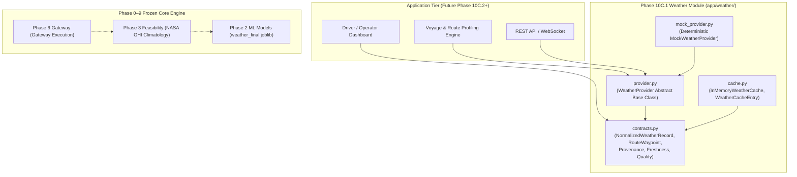

# PHASE 10C.1 — WEATHER PROVIDER ABSTRACTION & NORMALIZED CONTRACT

**Document Version:** 1.0.0  
**Phase:** 10C.1 (Data Foundation Layer)  
**Status:** IMPLEMENTED / VERIFIED / READY FOR FREEZE  
**Target Module:** `app/weather/`  
**Test Suite:** `tests/test_weather_provider.py`  

---

## 1. Purpose & Scope

Phase 10C.1 establishes the data foundation for weather integration across the Maritime Grids platform. It provides:
1. A provider-agnostic abstraction for live, historical, forecast, and route weather queries.
2. A strongly-typed, Pydantic V2 normalized weather record contract.
3. Explicit provenance tracking, quality classification, and temporal freshness evaluation.
4. A deterministic mock provider for testing without external network or API key dependencies.
5. An in-memory cache contract with TTL expiration to prevent redundant API calls.
6. A formal physical-model audit identifying that **wind-assisted propulsion is currently a capability gap** and is not part of the frozen core engine.

---

## 2. Architecture & Component Hierarchy

The weather module is located in `app/weather/` and integrates alongside the Phase 10A facade:



---

## 3. Weather Provider Interface

The abstract base class [`WeatherProvider`](file:///C:/maritime%20grids/app/weather/provider.py) defines four primary methods:

```python
class WeatherProvider(ABC):
    @property
    @abstractmethod
    def provider_name(self) -> str:
        """Unique identifier name for the provider."""
        pass

    @abstractmethod
    def get_current_weather(self, latitude: float, longitude: float) -> NormalizedWeatherRecord:
        """Fetch current weather for coordinates."""
        pass

    @abstractmethod
    def get_historical_weather(self, latitude: float, longitude: float, timestamp: Union[datetime, str]) -> NormalizedWeatherRecord:
        """Fetch point-in-time historical weather."""
        pass

    @abstractmethod
    def get_forecast_weather(self, latitude: float, longitude: float, horizon_hours: int = 24, step_hours: int = 1) -> List[NormalizedWeatherRecord]:
        """Fetch forecast time-series."""
        pass

    def get_route_weather(self, waypoints: List[RouteWaypoint], route_id: str = "ROUTE_001", vessel_id: Optional[str] = None) -> RouteWeatherProfile:
        """Sequence weather observations across navigational waypoints."""
        ...
```

---

## 4. Normalized Weather Schema & Field Mapping

The [`NormalizedWeatherRecord`](file:///C:/maritime%20grids/app/weather/contracts.py) defines mandatory geographic coordinates and timestamps, accompanied by optional physical atmospheric and oceanic fields:

| Field | Type | Units | Bounds / Validation | Handling if Unavailable |
|---|---|---|---|---|
| `latitude` | `float` | deg | $-90.0 \le \text{lat} \le 90.0$ | **Required** |
| `longitude` | `float` | deg | $-180.0 \le \text{lon} \le 180.0$ | **Required** |
| `timestamp_utc` | `str` | ISO 8601 | Normalized UTC string | **Required** |
| `retrieval_timestamp_utc` | `Optional[str]` | ISO 8601 | Normalized UTC string | `None` |
| `data_source` | `str` | text | Min length 1 | **Required** |
| `data_type` | `WeatherProvenanceType` | enum | Enum validation | **Required** |
| `data_quality` | `WeatherQualityState` | enum | Enum validation | `VALID` (default) |
| `freshness` | `WeatherFreshnessState` | enum | Enum validation | `UNKNOWN` (default) |
| `freshness_age_seconds` | `Optional[float]` | sec | $\ge 0.0$ | `None` |
| `wind_speed_ms` | `Optional[float]` | m/s | $\ge 0.0$ | `None` (Never 0.0) |
| `wind_speed_knots` | `Optional[float]` | knots | $\ge 0.0$ | `None` (Auto-synced with ms) |
| `wind_direction_deg` | `Optional[float]` | deg | $0.0 \le \text{dir} \le 360.0$ | `None` (Modulo normalized) |
| `temperature_c` | `Optional[float]` | °C | $-100.0 \le T \le 70.0$ | `None` |
| `relative_humidity_pct` | `Optional[float]` | % | $0.0 \le \text{RH} \le 100.0$ | `None` |
| `surface_pressure_hpa` | `Optional[float]` | hPa | $500.0 \le P \le 1100.0$ | `None` |
| `solar_irradiance_w_per_m2` | `Optional[float]` | W/m² | $\ge 0.0$ | `None` |
| `daily_ghi_kwh_per_m2` | `Optional[float]` | kWh/m²/day | $\ge 0.0$ | `None` |
| `cloud_cover_pct` | `Optional[float]` | % | $0.0 \le \text{CC} \le 100.0$ | `None` |
| `precipitation_mm_per_hr` | `Optional[float]` | mm/hr | $\ge 0.0$ | `None` |
| `wave_height_m` | `Optional[float]` | m | $\ge 0.0$ | `None` (Never 0.0) |
| `wave_direction_deg` | `Optional[float]` | deg | $0.0 \le \text{dir} \le 360.0$ | `None` (Modulo normalized) |
| `wave_period_s` | `Optional[float]` | s | $\ge 0.0$ | `None` |
| `ocean_current_speed_knots` | `Optional[float]` | knots | $\ge 0.0$ | `None` |
| `ocean_current_direction_deg`| `Optional[float]` | deg | $0.0 \le \text{dir} \le 360.0$ | `None` (Modulo normalized) |

> [!IMPORTANT]
> **Missing Value Handling (CRITICAL INVARIANT):**  
> Unavailable fields are explicitly represented by `None`. They are **never** silently populated with `0.0`. In maritime physics, $0.0\text{ m/s}$ wind or $0.0\text{ m}$ wave height denotes calm sea conditions, whereas `None` denotes absence of measurement.

---

## 5. Provenance, Quality, & Freshness Semantics

### 5.1 Provenance Types (`WeatherProvenanceType`)
- `OBSERVED`: Real physical telemetry from vessel sensors or weather stations.
- `HISTORICAL`: Reanalysis or recorded observation from a past timestamp.
- `FORECAST`: Numerical weather prediction model output valid for a future timestamp.
- `MODEL_PREDICTION`: Machine learning surrogate model output (e.g. Phase 2 classifier).
- `SIMULATED`: Synthetic benchmark or scenario generation fixture.
- `UNAVAILABLE`: Explicit missing provenance record.

### 5.2 Quality States (`WeatherQualityState`)
- `VALID`: Comprehensive physical fields available and within valid physical bounds.
- `PARTIAL`: Incomplete field coverage (e.g. atmospheric data present, oceanic missing), but valid where provided.
- `INVALID`: Field out-of-bounds or corrupted; **rejected by Pydantic before entering calculations**.
- `UNAVAILABLE`: No weather variables available.

### 5.3 Freshness States (`WeatherFreshnessState`)
Evaluated via `record.evaluate_freshness(current_time_utc)`:
- `FRESH`: Age $\le 1\text{ hour}$ (or future forecast).
- `STALE`: $1\text{ hour} < \text{Age} \le 24\text{ hours}$.
- `EXPIRED`: $\text{Age} > 24\text{ hours}$.
- `UNKNOWN`: Timestamp unparseable or absent.

---

## 6. Mock Weather Provider

[`MockWeatherProvider`](file:///C:/maritime%20grids/app/weather/mock_provider.py) provides 100% deterministic test fixtures:
- **Mathematical Basis:** Deterministic trigonometric harmonics of latitude, longitude, day of year, and hour angle.
- **Zero Flakiness:** No pseudo-random number generation (`random` is not imported).
- **Fault Simulation Modes:**
  - `normal`: Generates complete, physically consistent marine & atmospheric weather.
  - `missing_fields`: Omits oceanic and solar variables (produces `PARTIAL` records).
  - `stale`: Generates timestamps shifted 48 hours into the past (produces `EXPIRED` records).
  - `invalid`: Violates boundary conditions for negative test validation.
  - `field_overrides`: Injects exact field values for deterministic scenario testing.

---

## 7. Weather Caching Contract

[`InMemoryWeatherCache`](file:///C:/maritime%20grids/app/weather/cache.py) manages caching of weather queries:
- **Deterministic Key Structure:** `wx:{provider}:{lat:.4f}:{lon:.4f}:{sha256_hash}`
- **TTL Validation:** Records automatically expire after `ttl_seconds` (default: 3600s / 1 hour).
- **Purge Support:** `cleanup_expired()` removes stale entries from memory.

---

## 8. Physical Model Audit: Wind Propulsion Capability Gap

A comprehensive inspection of the frozen repository was conducted across Phases 0–9:

### 8.1 Existing Weather Variable Usage Inventory

| Variable | Exists? | Historical? | Live? | Forecast? | Used by ML? | Used by Phase 6? | Used by Phase 7/8/9? |
|---|---|---|---|---|---|---|---|
| **wind speed** | YES | YES (2020–2024 NASA POWER) | NO | NO | YES (`WS10M`, `WS50M` in `weather_final`, `fuel_xgb`) | YES (`WS10M` in `WeatherPrediction`) | NO |
| **wind direction** | YES | YES (NASA POWER `WD10M`) | NO | NO | NO (Filtered in Stage 2A) | NO | NO |
| **humidity** | YES | YES (NASA POWER `RH2M`) | NO | NO | YES (`RH2M` in `weather_final`) | YES (Passed to `weather_final`) | NO |
| **temperature** | YES | YES (NASA POWER `T2M_MIN`) | NO | NO | YES (`T2M_MIN` in `weather_final`) | YES (Passed to `weather_final`) | NO |
| **solar irradiance/GHI** | YES | YES (NASA POWER Climatology) | NO | NO | NO | YES (`lookup_solar_climatology_ghi`) | YES (Phase 8 sizing & Phase 9) |
| **cloud cover** | NO | NO | NO | NO | NO | NO | NO |
| **precipitation** | NO | NO | NO | NO | NO | NO | NO |
| **pressure** | YES | YES (NASA POWER `PS`) | NO | NO | YES (`PS` in `weather_final`) | YES (Passed to `weather_final`) | NO |
| **wave height** | YES | YES (Open-Meteo Marine) | NO | NO | YES (`wave_height_max` in ML) | YES (`significant_wave_height_m`) | NO |
| **wave direction** | YES | YES (Open-Meteo Marine) | NO | NO | YES (`wave_direction_dominant`) | YES (Passed to `weather_final`) | NO |
| **wave period** | YES | YES (Open-Meteo Marine) | NO | NO | YES (`wave_period_max`) | YES (Passed to `weather_final`) | NO |
| **ocean current speed** | NO | NO | NO | NO | NO | NO | NO |
| **ocean current direction** | NO | NO | NO | NO | NO | NO | NO |

### 8.2 Audit Conclusion: Wind Propulsion Gap

```text
================================================================================
WIND PROPULSION CAPABILITY GAP — NOT IMPLEMENTED
================================================================================
```

- **Findings:** The codebase contains **zero** physical models for:
  - Wind-assisted propulsion (WAPS), sails, Flettner rotors, or kites.
  - Aerodynamic lift/drag or thrust forces derived from wind vectors.
  - Auxiliary engine-off duration or fuel reduction credited to wind propulsion.
- **Rule:** Wind speed data must **never** be used to claim auxiliary power displacement or engine-off duration without a validated aerodynamic model.

---

## 9. Test Verification & Regression Results

Dedicated test suite: [`tests/test_weather_provider.py`](file:///C:/maritime%20grids/tests/test_weather_provider.py)

- **Phase 10C.1 Dedicated Tests:** `20 / 20 PASS`
- **Phase 10A Facade Tests:** `16 / 16 PASS`
- **Phase 0–9 Frozen Regression Tests:** `481 / 481 PASS`
- **Combined Test Suite Total:** **`517 / 517 PASS`**

---

## 10. File Integrity & Frozen Core Protection

- **Models:** 13/13 models (`models/*.joblib`) remain 100% bit-identical and UNCHANGED.
- **Reference Data:** `data/reference/ship_profiles.csv` remains UNCHANGED (`0f2040a481790b03...`).
- **Raw Data:** All 6,228 raw files remain UNCHANGED.
- **Frozen Modules:** Zero modifications to `phase*.py` files or Phase 10A facade files.

---

## 11. Next-Phase Dependencies (Phase 10C.2+)

The completed Phase 10C.1 data foundation unblocks future modules:
1. **Live Weather Provider Adapter:** Connecting to real Open-Meteo / NOAA / Copernicus REST APIs using the `WeatherProvider` interface.
2. **Voyage Route Weather Profiler:** Ingesting GPS waypoints and fetching forecast series for route optimization.
3. **Driver Dashboard Feed:** Emitting `DriverDashboardWeatherSummary` telemetry packets to web and desktop dashboards.

---

## 12. Final Status Declaration

```text
================================================================================
PHASE 10C.1 — IMPLEMENTED / VERIFIED / READY FOR FREEZE
================================================================================
```
