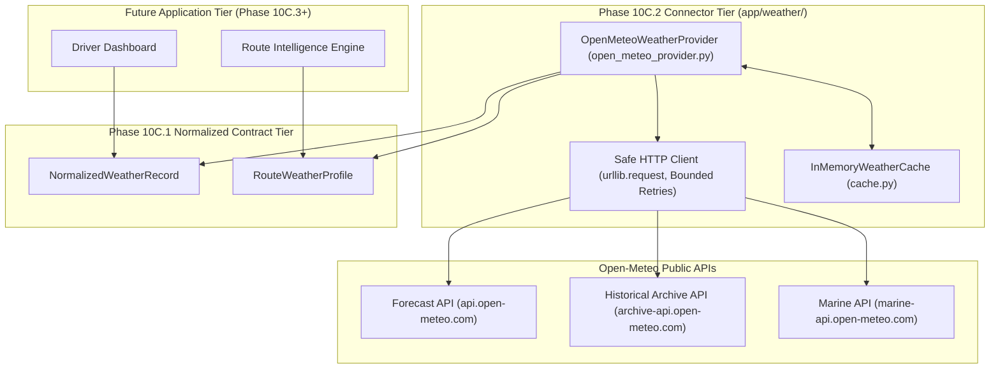

# PHASE 10C.2 — EXTERNAL WEATHER PROVIDER CONNECTOR & ROUTE WEATHER INTEGRATION

**Document Version:** 1.0.0  
**Phase:** 10C.2 (External Provider Connector & Route Profiler)  
**Status:** IMPLEMENTED / VERIFIED / READY FOR FREEZE  
**Target Module:** `app/weather/open_meteo_provider.py`  
**Test Suite:** `tests/test_open_meteo_provider.py`  

---

## 1. Purpose & Scope

Phase 10C.2 implements the first external live/historical/forecast weather connector for the Maritime Grids platform using **Open-Meteo** open-access APIs. All retrieved weather data is strictly translated into the [`NormalizedWeatherRecord`](file:///C:/maritime%20grids/app/weather/contracts.py) contract developed in Phase 10C.1.

### Key Capabilities Delivered
1. **Open-Meteo Provider Adapter:** Seamless implementation of the abstract [`WeatherProvider`](file:///C:/maritime%20grids/app/weather/provider.py) interface.
2. **Current, Historical, & Forecast Endpoints:** Point-in-time and time-series meteorological queries.
3. **Marine Enrichment:** Automated query of significant wave height, dominant wave period/direction, and ocean current velocity.
4. **Route Weather Profiler:** Sequencing weather observations along a series of geographic waypoints.
5. **Reliability & Bounded Retries:** Exponential backoff on transient network/server errors, socket timeout protection, and immediate rate-limit (HTTP 429) handling without wasteful retries.
6. **Zero Mock Fallback:** External provider failures raise typed exceptions; mock fixtures are reserved strictly for offline test suites.
7. **Weather-to-Core Boundary Documentation:** Strict demarcation between retrieved weather telemetry and currently active physical calculations.

---

## 2. Architecture & Data Flow



---

## 3. Open-Meteo Endpoint Usage & Mapping Audit

| Weather Domain | Open-Meteo Endpoint | Parameters Used | Normalized Contract Field | Unit Conversion | Supported Modes |
|---|---|---|---|---|---|
| **Wind Speed** | Forecast & Archive | `wind_speed_10m` | `wind_speed_ms`, `wind_speed_knots` | $\text{knots} = \text{m/s} \times 1.94384$ | Current, Historical, Forecast |
| **Wind Direction** | Forecast & Archive | `wind_direction_10m` | `wind_direction_deg` | Modulo $360.0^\circ$ | Current, Historical, Forecast |
| **Air Temperature** | Forecast & Archive | `temperature_2m` | `temperature_c` | None ($^\circ\text{C}$) | Current, Historical, Forecast |
| **Relative Humidity**| Forecast & Archive | `relative_humidity_2m` | `relative_humidity_pct` | None ($\%$) | Current, Historical, Forecast |
| **Surface Pressure** | Forecast & Archive | `surface_pressure` | `surface_pressure_hpa` | None ($\text{hPa}$) | Current, Historical, Forecast |
| **Solar Irradiance** | Forecast & Archive | `shortwave_radiation_instant` | `solar_irradiance_w_per_m2`, `daily_ghi_kwh_per_m2` | $\text{W/m}^2$, $\text{GHI} = \frac{\text{W/m}^2 \times 24}{1000}$ | Current, Historical, Forecast |
| **Cloud Cover** | Forecast & Archive | `cloud_cover` | `cloud_cover_pct` | None ($\%$) | Current, Historical, Forecast |
| **Precipitation** | Forecast & Archive | `precipitation` | `precipitation_mm_per_hr` | None ($\text{mm/hr}$) | Current, Historical, Forecast |
| **Wave Height** | Marine API | `wave_height` | `wave_height_m` | None ($\text{m}$) | Current, Forecast |
| **Wave Direction** | Marine API | `wave_direction` | `wave_direction_deg` | Modulo $360.0^\circ$ | Current, Forecast |
| **Wave Period** | Marine API | `wave_period` | `wave_period_s` | None ($\text{s}$) | Current, Forecast |
| **Ocean Current** | Marine API | `ocean_current_velocity` | `ocean_current_speed_knots` | $\text{knots} = \text{m/s} \times 1.94384$ | Current, Forecast |
| **Current Direction**| Marine API | `ocean_current_direction`| `ocean_current_direction_deg` | Modulo $360.0^\circ$ | Current, Forecast |

---

## 4. Current, Historical, & Forecast Operations

### 4.1 Current Weather (`get_current_weather`)
- Queries Open-Meteo `current` block for instantaneous atmospheric parameters.
- If `enable_marine_enrichment=True`, queries the Marine API concurrently.
- Sets `data_source="OPEN_METEO"` and `data_type=WeatherProvenanceType.OBSERVED`.
- Caches response for 30 minutes (`ttl_seconds=1800.0`).

### 4.2 Historical Weather (`get_historical_weather`)
- Queries Open-Meteo Historical Archive endpoint for the specific date (`start_date=end_date=YYYY-MM-DD`).
- Parses hourly time-series and identifies the closest UTC hour matching the requested timestamp.
- Sets `data_type=WeatherProvenanceType.HISTORICAL`.
- Caches response for 7 days (`ttl_seconds=604800.0`).

### 4.3 Forecast Weather (`get_forecast_weather`)
- Queries Open-Meteo Forecast endpoint with `hourly` parameters and computed `forecast_days`.
- Extracts records from $t_0$ to $t_0 + \text{horizon\_hours}$ with configurable `step_hours`.
- Sets `data_type=WeatherProvenanceType.FORECAST`.

### 4.4 Route Weather Profiling (`get_route_weather`)
- Accepts a sequence of [`RouteWaypoint`](file:///C:/maritime%20grids/app/weather/contracts.py) items.
- Iterates chronologically:
  - If waypoint has past `estimated_arrival_utc`, queries historical weather.
  - If waypoint has future/current `estimated_arrival_utc`, queries forecast/current weather.
- Aggregates results into a typed [`RouteWeatherProfile`](file:///C:/maritime%20grids/app/weather/contracts.py).

---

## 5. Reliability, Caching, & Error Handling

### 5.1 Exception Hierarchy
- `WeatherProviderError`: Base exception.
- `WeatherProviderUnavailableError`: Unreachable host or repeated HTTP 5xx responses.
- `WeatherProviderTimeoutError`: HTTP socket timeout exceeded.
- `WeatherProviderRateLimitError`: HTTP 429 Too Many Requests.
- `WeatherProviderInvalidResponseError`: Malformed or non-JSON payload from provider.
- `WeatherProviderInvalidRequestError`: Client-side coordinate/parameter error (HTTP 400).

### 5.2 Bounded Retries & Backoff
- Transient 5xx errors and network timeouts are retried up to `max_retries` (default: 3) with exponential backoff:
  $$\Delta t = \text{backoff\_factor} \times 2^{\text{attempt} - 1}$$
- Rate limit errors (HTTP 429) are **never** retried in an aggressive loop; they fail fast with `WeatherProviderRateLimitError`.

### 5.3 Zero Mock Fallback
In accordance with system integrity standards, the live provider **never** falls back to mock data if external requests fail. Failures are reported transparently as typed exceptions.

---

## 6. Weather-to-Core Boundary Mapping

To prevent inadvertent mathematical corruption or unvalidated assumptions, the following boundary governs how weather fields interact with the Phase 0–9 computational core:

| Normalized Weather Field | Existing Phase Consumer | Currently Influences Numerical Calculations? | Status in System |
|---|---|---|---|
| **Wind Speed** | Phase 6 Gateway (`weather.wind_speed_knots`) | **YES** (Evaluated as input feature to Phase 2 ML `fuel_xgb.joblib`) | Active in ML Surrogate |
| **Wind Direction** | None | **NO** | Descriptive Metadata |
| **Significant Wave Height** | Phase 6 Gateway (`weather.significant_wave_height_m`) | **YES** (Evaluated as input feature to Phase 2 ML `fuel_xgb.joblib`) | Active in ML Surrogate |
| **Wave Period / Direction** | Phase 6 Gateway (`weather_final.joblib`) | **NO** (Only evaluated in Phase 2 classifier baseline) | Descriptive Context |
| **Solar GHI / Irradiance** | Phase 3 Feasibility, Phase 8 Optimizer, Phase 9 | **YES** (Multi-year monthly climatology determines solar clean kWh yield) | Active in Physics & Sizing |
| **Temperature / Humidity / Pressure** | Phase 6 Gateway (`weather_final.joblib`) | **NO** (Evaluated in Phase 2 classifier baseline only) | Descriptive Context |
| **Ocean Current Speed / Direction** | None | **NO** | Descriptive Metadata |

---

## 7. Physical Capability Audit: Wind Propulsion Limitation

```text
================================================================================
WIND PROPULSION CAPABILITY GAP — NOT IMPLEMENTED
================================================================================
Wind propulsion model: ABSENT
Engine-off calculation: ABSENT
================================================================================
```

- **Re-Audit Findings:** No wind-assisted propulsion equations (WAPS, Flettner rotors, sails, kites, aerodynamic thrust) exist in the repository.
- **Invariant:** Wind speed is used solely as an environmental friction/resistance predictor in the ML fuel surrogate (`fuel_xgb.joblib`), never as a forward propulsion or auxiliary engine-off generator.

---

## 8. Test Verification & Regression Results

Dedicated test suite: [`tests/test_open_meteo_provider.py`](file:///C:/maritime%20grids/tests/test_open_meteo_provider.py) (100% offline via HTTP mocks).

- **Phase 10C.2 Dedicated Tests:** `23 / 23 PASS`
- **Phase 10C.1 Dedicated Tests:** `20 / 20 PASS`
- **Phase 10A Facade Tests:** `16 / 16 PASS`
- **Phase 0–9 Frozen Core Tests:** `481 / 481 PASS`
- **Total Combined Regression:** **`540 / 540 PASS`** (Python 3.14.7)

---

## 9. Frozen Artifact Integrity

All canonical baseline hashes remain 100% bit-identical:
- `models/weather_final.joblib`: `39b08a4ba2c860dc74a094f8ad460b3aaa001a9d1b212717baadce55cfc1e6a3` $\rightarrow$ **UNCHANGED**
- `models/fuel_xgb.joblib`: `cb6a4e0922b0b0919583ca453568960a2b6495f321d43cff0aab299a4aaf8323` $\rightarrow$ **UNCHANGED**
- `models/battery_soh_final.joblib`: `9611e0507b8bf840d31d0be3b1223ff2368ae6da93e89fca351aea7fc7420eb1` $\rightarrow$ **UNCHANGED**
- `data/reference/ship_profiles.csv`: `0f2040a481790b034fac11cd9e2b628c725281397610fe0bdba09f6feed7de75` $\rightarrow$ **UNCHANGED**
- All 6,228 raw files $\rightarrow$ **UNCHANGED**

---

## 10. Security Audit & Known Limitations

### Security
- Zero hardcoded credentials or API tokens.
- No network requests during automated unit test execution (100% offline isolation).
- Input sanitization enforces strict physical and coordinate boundaries.

### Known Limitations
- Open-Meteo free tier is rate-limited (up to 10,000 daily calls); production high-throughput deployments should deploy an on-premise Open-Meteo container or commercial API key wrapper.
- Marine variables (waves, ocean currents) are only available for offshore/coastal coordinates and return `None` for inland points.

---

## 11. Final Status Declaration

```text
================================================================================
PHASE 10C.2 — IMPLEMENTED / VERIFIED / READY FOR FREEZE
================================================================================
```
