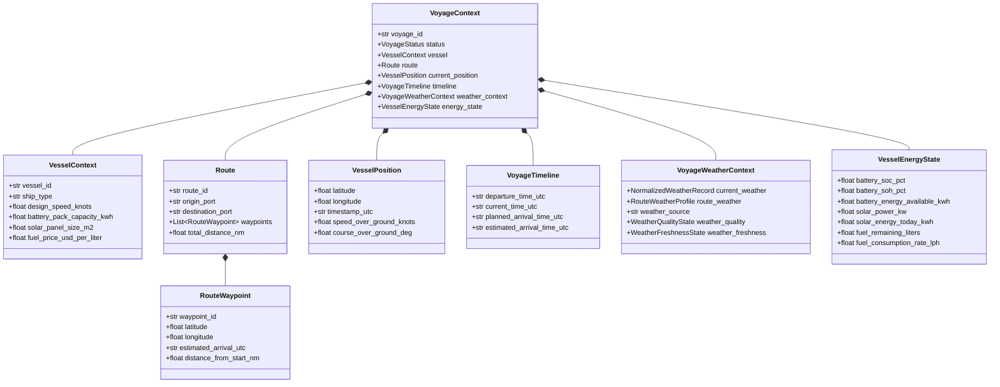

# PHASE 10C.3 — VOYAGE STATE, ROUTE REPRESENTATION, & WEATHER-AWARE VOYAGE CONTEXT

**Document Version:** 1.0.0  
**Phase:** 10C.3 (Voyage State & Weather-Aware Context Layer)  
**Status:** IMPLEMENTED / VERIFIED / READY FOR FREEZE  
**Target Module:** `app/voyage/`  
**Test Suite:** `tests/test_voyage_context.py`  

---

## 1. Purpose & Scope

Phase 10C.3 establishes the application-level data models and state management for:
1. **Vessel Context:** Profiles referencing ship design characteristics, propulsion setups, and clean battery/solar capacities.
2. **Route Representation:** Sequenced chains of geographic waypoints connecting origin and destination ports.
3. **Voyage State & Telemetry:** Lifecycle states (`PLANNED`, `ACTIVE`, `PAUSED`, `COMPLETED`, `CANCELLED`), real-time geographic position fixes, and voyage timeline tracking.
4. **Vessel Energy State:** Usable battery capacity, state of charge (SoC), state of health (SoH), instantaneous solar yield, and fuel remaining.
5. **Weather-Aware Voyage Context:** Aggregated state integrating current environmental observations and route forecast profiles via Phase 10C.1 / 10C.2 weather providers.
6. **Strict Invariant Protection:** Pure state container layer — **zero physics recomputation**, zero unvalidated wind propulsion assumptions, and explicit preservation of missing values.

---

## 2. Architecture & Data Model Structure



---

## 3. Contract Specifications

### 3.1 Vessel Context ([`VesselContext`](file:///C:/maritime%20grids/app/voyage/contracts.py#L38-L58))
- `vessel_id`: Unique identifier (e.g. `'VESSEL_OSV_01'`).
- `ship_type`: Matches one of the 4 reference types (`'Oil Service Boat'`, `'Fishing Trawler'`, `'Surfer Boat'`, `'Tanker Ship'`) or custom profile.
- Equipment attributes: `battery_pack_capacity_kwh`, `solar_panel_size_m2`, `engine_power_kw`, `fuel_price_usd_per_liter`.
- Explicit `None` if specific hardware is uninstalled or unknown.

### 3.2 Route & Waypoints ([`Route`](file:///C:/maritime%20grids/app/voyage/contracts.py#L65-L87))
- `route_id`, `origin_port`, `destination_port`.
- `waypoints`: List of [`RouteWaypoint`](file:///C:/maritime%20grids/app/weather/contracts.py#L190-L208) (minimum 2 waypoints required).
- Validates latitude in $[-90.0, 90.0]$ and longitude in $[-180.0, 180.0]$.

### 3.3 Voyage Lifecycle Status ([`VoyageStatus`](file:///C:/maritime%20grids/app/voyage/contracts.py#L27-L33))
Supported operational states:
- `PLANNED`: Route defined, not yet underway.
- `ACTIVE`: Vessel currently navigating the route.
- `PAUSED`: Vessel anchored or awaiting berth clearance.
- `COMPLETED`: Voyage finished at destination port.
- `CANCELLED`: Voyage aborted.

### 3.4 Vessel Position & Timeline ([`VesselPosition`](file:///C:/maritime%20grids/app/voyage/contracts.py#L94-L108), [`VoyageTimeline`](file:///C:/maritime%20grids/app/voyage/contracts.py#L115-L128))
- Instantaneous coordinates and speed/course over ground.
- ISO 8601 UTC normalized timestamps.
- If dynamic ETA is not yet computed, `estimated_arrival_time_utc` remains `None` (explicitly unavailable, never fake).

### 3.5 Vessel Energy State ([`VesselEnergyState`](file:///C:/maritime%20grids/app/voyage/contracts.py#L135-L148))
- Real-time clean power state: `battery_soc_pct`, `battery_soh_pct`, `battery_energy_available_kwh`, `solar_power_kw`, `solar_energy_today_kwh`, `fuel_remaining_liters`, `fuel_consumption_rate_lph`.
- Missing fields default to `None` (never silently 0.0).

---

## 4. Weather-Aware Context Integration

[`VoyageWeatherContext`](file:///C:/maritime%20grids/app/voyage/contracts.py#L155-L177) encapsulates:
- `current_weather`: Instantaneous [`NormalizedWeatherRecord`](file:///C:/maritime%20grids/app/weather/contracts.py) at the vessel position.
- `route_weather`: Complete [`RouteWeatherProfile`](file:///C:/maritime%20grids/app/weather/contracts.py) along route waypoints.
- Automated metadata synchronization: `weather_quality`, `weather_freshness`, `weather_source`.

### Fluent Builder ([`VoyageContextBuilder`](file:///C:/maritime%20grids/app/voyage/context_builder.py))
Assembles a valid `VoyageContext` and enriches it with weather telemetry via any `WeatherProvider`:
```python
builder = VoyageContextBuilder("VOY_2026_001")
builder.set_vessel(vessel)
builder.set_route(route)
builder.set_position(position)
builder.enrich_weather_from_provider(open_meteo_provider)
voyage_context = builder.build()
```

---

## 5. Physical Model Audit & Boundary Enforcement

```text
================================================================================
WIND PROPULSION CAPABILITY GAP — NOT IMPLEMENTED
================================================================================
Wind propulsion model: ABSENT
Engine-off calculation: ABSENT
================================================================================
```

- **Invariant:** `VoyageContext` does **not** recalculate fuel, power, emissions, financial returns, or wind propulsion. It functions strictly as an application state container.

---

## 6. Testing & Full Regression Results

Dedicated test suite: [`tests/test_voyage_context.py`](file:///C:/maritime%20grids/tests/test_voyage_context.py)

- **Phase 10C.3 Dedicated Tests:** `24 / 24 PASS`
- **Phase 10C.2 Open-Meteo Tests:** `23 / 23 PASS`
- **Phase 10C.1 Weather Tests:** `20 / 20 PASS`
- **Phase 10A Facade Tests:** `16 / 16 PASS`
- **Phase 0–9 Core Regression Tests:** `481 / 481 PASS`
- **Total Combined Regression Suite:** **`564 / 564 PASS`** (Python 3.14.7)

---

## 7. Frozen Artifact Integrity

All canonical baseline hashes remain 100% bit-identical:
- `models/weather_final.joblib`: `39b08a4ba2c860dc74a094f8ad460b3aaa001a9d1b212717baadce55cfc1e6a3` $\rightarrow$ **UNCHANGED**
- `models/fuel_xgb.joblib`: `cb6a4e0922b0b0919583ca453568960a2b6495f321d43cff0aab299a4aaf8323` $\rightarrow$ **UNCHANGED**
- `models/battery_soh_final.joblib`: `9611e0507b8bf840d31d0be3b1223ff2368ae6da93e89fca351aea7fc7420eb1` $\rightarrow$ **UNCHANGED**
- `data/reference/ship_profiles.csv`: `0f2040a481790b034fac11cd9e2b628c725281397610fe0bdba09f6feed7de75` $\rightarrow$ **UNCHANGED**
- All 6,228 raw data files $\rightarrow$ **UNCHANGED**

---

## 8. Final Status Declaration

```text
================================================================================
PHASE 10C.3 — IMPLEMENTED / VERIFIED / READY FOR FREEZE
================================================================================
```
