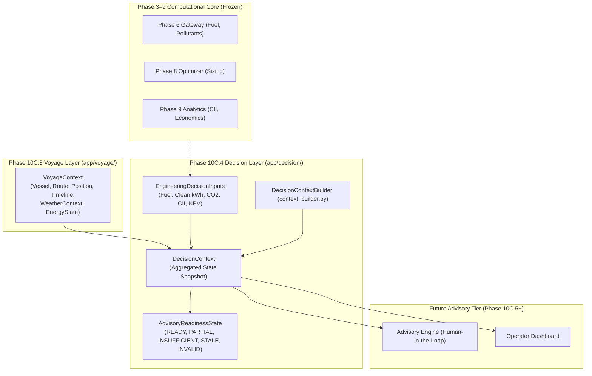
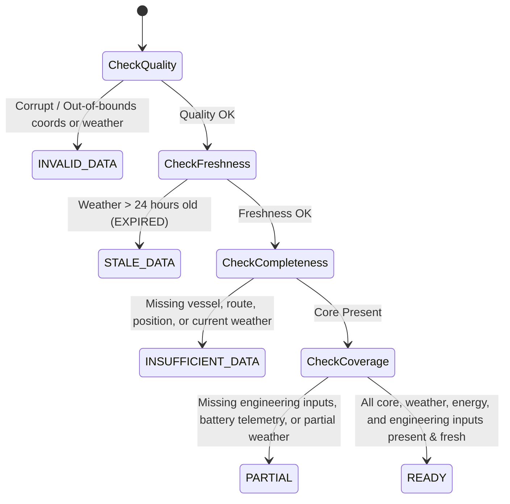

# PHASE 10C.4 — DECISION CONTEXT & ADVISORY INPUT CONTRACT

**Document Version:** 1.0.0  
**Phase:** 10C.4 (Decision Context & Advisory Input Layer)  
**Status:** IMPLEMENTED / VERIFIED / READY FOR FREEZE  
**Target Module:** `app/decision/`  
**Test Suite:** `tests/test_decision_context.py`  

---

## 1. Purpose & Scope

Phase 10C.4 implements the application-level decision context foundation for the Maritime Grids platform. It provides:
1. **Decision Context Contract:** [`DecisionContext`](file:///C:/maritime%20grids/app/decision/contracts.py) aggregating vessel profile, voyage route, instantaneous position fix, timeline, weather observations, energy states, and upstream engineering estimates.
2. **Readiness State Evaluation:** Deterministic classification of advisory readiness across 5 states: `READY`, `PARTIAL`, `INSUFFICIENT_DATA`, `STALE_DATA`, and `INVALID_DATA`.
3. **Engineering-Core Boundary:** Cleanly ingests pre-computed Phase 3–9 baseline metrics (fuel, clean energy budget, CO2, CII rating, NPV) **without recomputing or duplicating physics formulas**.
4. **Human-in-the-Loop Demarcation:** Purely an input context contract — provides **zero autonomous control**, no engine commands, and no automatic route mutations.
5. **Wind Propulsion Boundary:** Re-verifies that wind-assisted propulsion models remain absent from the platform.

---

## 2. Architecture & Component Hierarchy



---

## 3. Decision Context Contract ([`DecisionContext`](file:///C:/maritime%20grids/app/decision/contracts.py#L65-L148))

### 3.1 Structure & Key Fields

| Field | Type | Description | Handling if Unavailable |
|---|---|---|---|
| `decision_context_id` | `str` | Unique snapshot identifier | **Required** (Validated non-empty) |
| `created_at_utc` | `str` | ISO 8601 UTC creation timestamp | **Required** (Normalized UTC) |
| `voyage_context` | `VoyageContext` | Underlying voyage, vessel, position, weather, and energy state | **Required** |
| `engineering_inputs` | `Optional[EngineeringDecisionInputs]` | Upstream simulation outputs (fuel, solar, battery, CII, NPV) | `None` (triggers `PARTIAL` readiness) |
| `readiness` | `AdvisoryReadinessState` | Automatic data completeness and validity classification | Computed in validator |
| `readiness_reasons` | `List[str]` | Diagnostic explanations for readiness state | Computed in validator |

### 3.2 Engineering Decision Inputs ([`EngineeringDecisionInputs`](file:///C:/maritime%20grids/app/decision/contracts.py#L46-L58))
- `baseline_fuel_consumption_liters`: Un-hybridized reference fuel consumption.
- `estimated_solar_energy_kwh`: Climatological solar energy generation.
- `estimated_battery_displacement_kwh`: Usable battery auxiliary power displacement.
- `total_clean_energy_kwh`: Combined clean energy budget (battery + solar).
- `co2_emissions_kg`: Estimated CO2 emissions across voyage.
- `cii_attained_rating`: Attained operational CII grade (`'A'`, `'B'`, `'C'`, `'D'`, `'E'`).
- `optimal_transit_speed_knots`: Recommended operating transit speed from Phase 9 Candidate 2.
- `net_present_value_usd` & `payback_period_years`: Financial appraisal indicators from Phase 7.

---

## 4. Advisory Readiness Semantics

The readiness validator evaluates the complete context and assigns one of 5 states:



1. **`READY`:** Vessel, route, position, fresh valid weather, energy telemetry, and engineering inputs are all present.
2. **`PARTIAL`:** Core navigation and weather exist, but optional telemetry (battery SoC, bunker fuel level) or engineering simulations are missing.
3. **`INSUFFICIENT_DATA`:** Critical navigation components (vessel, route, position) or weather observations are completely absent.
4. **`STALE_DATA`:** Weather observation has expired ($>24\text{ hours}$ old).
5. **`INVALID_DATA`:** Geographic coordinates or weather variables violate physical bounds.

---

## 5. Human-in-the-Loop & Safety Boundary

> [!CAUTION]
> **Human Decision Support Invariant:**  
> `DecisionContext` is an informational data model for advisory support. It **does not expose any APIs or commands for autonomous control**, throttle manipulation, automatic steering, or unauthorized route alterations. The human vessel operator remains the sole authority for operational decisions.

---

## 6. Physical Model Audit: Wind Propulsion Limitation

```text
================================================================================
WIND PROPULSION CAPABILITY GAP — NOT IMPLEMENTED
================================================================================
Wind propulsion model: ABSENT
Engine-off calculation: ABSENT
================================================================================
```
- **Audit Findings:** No wind-assisted propulsion equations (WAPS, Flettner rotors, sails, kites, aerodynamic thrust) exist in the codebase.
- **Rule:** Wind speed and direction are passed strictly as environmental telemetry, never as forward thrust.

---

## 7. Testing & Full Regression Results

Dedicated test suite: [`tests/test_decision_context.py`](file:///C:/maritime%20grids/tests/test_decision_context.py) (25 deterministic offline test cases).

- **Phase 10C.4 Dedicated Tests:** `25 / 25 PASS`
- **Phase 10C.3 Voyage Tests:** `24 / 24 PASS`
- **Phase 10C.2 Open-Meteo Tests:** `23 / 23 PASS`
- **Phase 10C.1 Weather Tests:** `20 / 20 PASS`
- **Phase 10A Facade Tests:** `16 / 16 PASS`
- **Phase 0–9 Core Regression Tests:** `481 / 481 PASS`
- **Total Combined Regression Suite:** **`589 / 589 PASS`** (Python 3.14.7)

---

## 8. Frozen Artifact Integrity

All canonical baseline hashes and raw data file counts remain 100% bit-identical:
- `models/weather_final.joblib`: `39b08a4ba2c860dc74a094f8ad460b3aaa001a9d1b212717baadce55cfc1e6a3` $\rightarrow$ **UNCHANGED**
- `models/fuel_xgb.joblib`: `cb6a4e0922b0b0919583ca453568960a2b6495f321d43cff0aab299a4aaf8323` $\rightarrow$ **UNCHANGED**
- `models/battery_soh_final.joblib`: `9611e0507b8bf840d31d0be3b1223ff2368ae6da93e89fca351aea7fc7420eb1` $\rightarrow$ **UNCHANGED**
- `models/battery_soc_lstm.pt`: `c2077e5111648234d7e3b3cc9b2944f1db95c1e6fedc1ea96fd0514e1f35ad25` $\rightarrow$ **UNCHANGED**
- `data/reference/ship_profiles.csv`: `0f2040a481790b034fac11cd9e2b628c725281397610fe0bdba09f6feed7de75` $\rightarrow$ **UNCHANGED**
- `data/raw/` file count: **6,228 files** $\rightarrow$ **UNCHANGED**

---

## 9. Final Status Declaration

```text
================================================================================
PHASE 10C.4 — IMPLEMENTED / VERIFIED / READY FOR FREEZE
================================================================================
```
