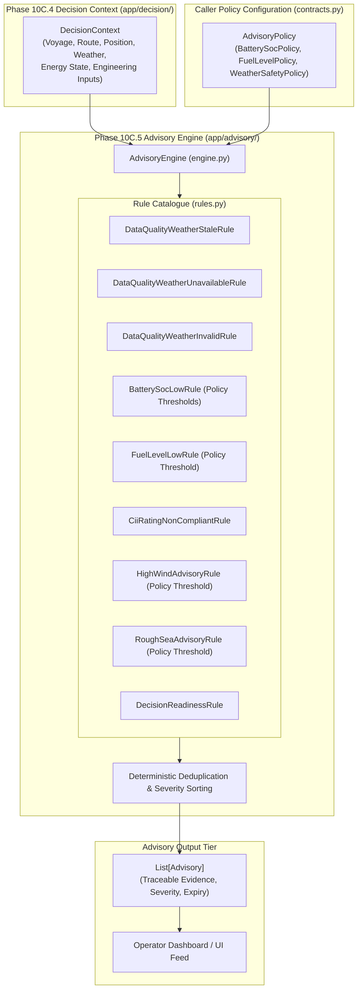

# PHASE 10C.5 — ADVISORY ENGINE CONTRACT & DETERMINISTIC RULE FOUNDATION

**Document Version:** 1.1.0 (Post-Provenance Remediation)  
**Phase:** 10C.5 (Advisory Engine & Deterministic Rule Layer)  
**Status:** IMPLEMENTED / VERIFIED / READY FOR FREEZE  
**Target Module:** `app/advisory/`  
**Test Suite:** `tests/test_advisory_engine.py`  

---

## 1. Purpose & Scope

Phase 10C.5 establishes the deterministic advisory framework for the Maritime Grids platform. It provides:
1. **Advisory Contract:** Strongly typed [`Advisory`](file:///C:/maritime%20grids/app/advisory/contracts.py) and [`AdvisoryEvidence`](file:///C:/maritime%20grids/app/advisory/contracts.py) schemas capturing operational recommendations and traceability.
2. **Explicit Policy Contracts:** Strongly typed [`BatterySocPolicy`](file:///C:/maritime%20grids/app/advisory/contracts.py), [`FuelLevelPolicy`](file:///C:/maritime%20grids/app/advisory/contracts.py), [`WeatherSafetyPolicy`](file:///C:/maritime%20grids/app/advisory/contracts.py), and [`AdvisoryPolicy`](file:///C:/maritime%20grids/app/advisory/contracts.py) configuring all numerical thresholds explicitly without hard-coded assumptions.
3. **Deterministic Rule Engine:** [`AdvisoryEngine`](file:///C:/maritime%20grids/app/advisory/engine.py) executing modular, explainable [`AdvisoryRule`](file:///C:/maritime%20grids/app/advisory/rules.py) objects against a [`DecisionContext`](file:///C:/maritime%20grids/app/decision/contracts.py).
4. **Core Rule Catalogue:** 9 deterministic rules covering weather data quality (stale, unavailable, invalid), energy reserves (battery SoC, bunker fuel), IMO CII compliance, rough seas/high wind safety, and decision readiness.
5. **Human-in-the-Loop Demarcation:** Strict safety invariant — `human_review_required = True` on all advisories. The engine contains **zero autonomous actuation, throttle manipulation, or route steering APIs**.
6. **Wind Propulsion Boundary:** Re-verified that wind-assisted propulsion models remain absent from the codebase.

---

## 2. Architecture & Rule Evaluation Flow



---

## 3. Threshold Policy & Provenance Remediation

### 3.1 Provenance Audit & Findings
A comprehensive codebase audit was conducted to verify the provenance of all operational thresholds used in advisory evaluation:

| Threshold Candidate | Prior Hard-Coded Default | Provenance Classification | Justification & Remediation |
|---|---|---|---|
| **Battery SoC Warning** | `20.0%` | `APPLICATION_POLICY` | No frozen upstream physical constant exists in Phase 0–9. Hard-coded default removed. Now configured via `BatterySocPolicy.warning_threshold_pct` (defaults to `None`). |
| **Battery SoC Notice** | `35.0%` | `APPLICATION_POLICY` | Operational guidance only. Hard-coded default removed. Now configured via `BatterySocPolicy.notice_threshold_pct` (defaults to `None`). |
| **Fuel Reserve Warning** | `1000.0 L` | `APPLICATION_POLICY` | Arbitrary operational margin for bunker reserves. Hard-coded default removed. Now configured via `FuelLevelPolicy.warning_threshold_liters` (defaults to `None`). |
| **High Wind Warning** | `25.0 knots` | `APPLICATION_POLICY` | Environmental safety threshold. Hard-coded default removed. Now configured via `WeatherSafetyPolicy.high_wind_threshold_knots` (defaults to `None`). |
| **Rough Sea Warning** | `2.5 m` | `APPLICATION_POLICY` | Environmental safety threshold. Hard-coded default removed. Now configured via `WeatherSafetyPolicy.rough_sea_threshold_m` (defaults to `None`). |
| **CII Non-Compliance** | Grades `'D'` & `'E'` | `FROZEN_REGULATORY_STANDARD` | IMO MARPOL Annex VI MEPC.336(76) regulatory standard established in Phase 6 / Phase 9. Preserved. |
| **Weather Freshness** | Stale / Expired states | `FROZEN_APPLICATION_CONTRACT` | Weather contract states defined in Phase 10C.1. Preserved. |
| **Decision Readiness** | `INSUFFICIENT_DATA` / `INVALID_DATA` | `FROZEN_APPLICATION_CONTRACT` | Readiness lifecycle states established in Phase 10C.4. Preserved. |

### 3.2 Invariant Guarantee: Zero Unconfigured False Alarms
When rules or the `AdvisoryEngine` are initialized without explicit policy parameters (i.e. all thresholds default to `None`):
- `BatterySocLowRule`: produces **zero** advisories regardless of battery SoC level.
- `FuelLevelLowRule`: produces **zero** advisories regardless of remaining fuel volume.
- `HighWindAdvisoryRule`: produces **zero** advisories regardless of observed wind speed.
- `RoughSeaAdvisoryRule`: produces **zero** advisories regardless of significant wave height.
- Missing telemetry (`None` values) never produces false alarms or triggers zero-value assumptions (`missing != 0`).

---

## 4. Advisory Contract & Evidence Model

### 4.1 Advisory Schema ([`Advisory`](file:///C:/maritime%20grids/app/advisory/contracts.py#L98-L151))

| Field | Type | Description | Invariant / Behavior |
|---|---|---|---|
| `advisory_id` | `str` | Unique instance ID | Validated non-empty |
| `rule_id` | `str` | Triggering rule ID | Verifiable traceability |
| `category` | `AdvisoryCategory` | Domain classification | `WEATHER`, `BATTERY`, `FUEL`, `CII`, `DATA_QUALITY`, `SYSTEM`, etc. |
| `severity` | `AdvisorySeverity` | Urgency rating | `INFO`, `NOTICE`, `WARNING`, `CRITICAL` |
| `title` | `str` | Headline summary | Concise operator notification |
| `message` | `str` | Detailed advisory text | Full context and operational guidance |
| `status` | `AdvisoryStatus` | Lifecycle state | `ACTIVE`, `EXPIRED`, `SUPPRESSED`, `INVALID` |
| `created_at_utc` | `str` | ISO 8601 UTC creation time | Normalized UTC |
| `valid_until_utc` | `Optional[str]` | Expiry timestamp | Evaluated via `is_expired()` |
| `evidence` | `List[AdvisoryEvidence]` | Traceable telemetry evidence | Records observed vs threshold values |
| `human_review_required` | `bool` | Human-in-the-loop flag | **Always `True`** |
| `deduplication_key` | `str` | Deterministic SHA-256 hash | Suppresses redundant active notifications |

### 4.2 Evidence Model ([`AdvisoryEvidence`](file:///C:/maritime%20grids/app/advisory/contracts.py#L74-L93))
Captures the raw telemetry, source field, observed value, threshold value, data provenance (`OBSERVED`, `SIMULATED`, etc.), data quality, freshness, and timestamp.

---

## 5. Rule Catalogue & Trigger Conditions

| Rule ID | Rule Class | Category | Severity | Policy-Driven Trigger Condition |
|---|---|---|---|---|
| `DQ_WX_STALE_001` | `DataQualityWeatherStaleRule` | `DATA_QUALITY` | `WARNING` / `NOTICE` | Weather freshness is `EXPIRED` or `STALE`. |
| `DQ_WX_UNAVAIL_002` | `DataQualityWeatherUnavailableRule` | `DATA_QUALITY` | `WARNING` | Current weather is `None` or `UNAVAILABLE`. |
| `DQ_WX_INVALID_003` | `DataQualityWeatherInvalidRule` | `DATA_QUALITY` | `CRITICAL` | Weather quality is marked `INVALID`. |
| `ENG_BATT_SOC_001` | `BatterySocLowRule` | `BATTERY` | `WARNING` / `NOTICE` | `battery_soc_pct < warning_threshold_pct` or `< notice_threshold_pct` (if configured). |
| `ENG_FUEL_LOW_002` | `FuelLevelLowRule` | `FUEL` | `WARNING` | `fuel_remaining_liters < reserve_threshold_liters` (if configured). |
| `REG_CII_NONCOMPLIANT_001`| `CiiRatingNonCompliantRule` | `CII` | `WARNING` | `cii_attained_rating` in `['D', 'E']` (SEEMP Part III plan needed). |
| `MET_WIND_HIGH_001` | `HighWindAdvisoryRule` | `WEATHER` | `WARNING` | `wind_speed_knots > high_wind_threshold_knots` (if configured). |
| `MET_SEA_ROUGH_002` | `RoughSeaAdvisoryRule` | `WEATHER` | `WARNING` | `wave_height_m > rough_sea_threshold_m` (if configured). |
| `SYS_READINESS_001` | `DecisionReadinessRule` | `SYSTEM` | `WARNING` | `DecisionContext.readiness` is `INSUFFICIENT_DATA` or `INVALID_DATA`. |

---

## 6. Human-in-the-Loop Safety & Autonomous Control Boundary

> [!CAUTION]
> **Safety Boundary Declaration:**  
> Phase 10C.5 provides **deterministic decision-support advisories only**. It does **not** autonomously control the vessel, manipulate engine throttles, steer rudders, alter planned waypoints, or execute recommendations without human operator review. `human_review_required` is unconditionally `True` on all generated advisories.

---

## 7. Physical Capability Audit: Wind Propulsion Limitation

```text
================================================================================
WIND PROPULSION CAPABILITY GAP — NOT IMPLEMENTED
================================================================================
Wind propulsion model: ABSENT
Engine-off calculation: ABSENT
================================================================================
```
- **Audit Findings:** No wind-assisted propulsion equations (WAPS, Flettner rotors, sails, kites, aerodynamic thrust) exist in the repository.
- **Rule Enforcement:** High wind advisories are framed strictly as aerodynamic drag / sea state safety notices, never as forward thrust or engine-off generators.

---

## 8. Testing & Full Regression Results

Dedicated test suite: [`tests/test_advisory_engine.py`](file:///C:/maritime%20grids/tests/test_advisory_engine.py) (45 deterministic offline test cases covering core rules and threshold provenance remediation).

- **Phase 10C.5 Dedicated Tests:** `45 / 45 PASS`
- **Phase 10C.4 Decision Tests:** `25 / 25 PASS`
- **Phase 10C.3 Voyage Tests:** `24 / 24 PASS`
- **Phase 10C.2 Open-Meteo Tests:** `23 / 23 PASS`
- **Phase 10C.1 Weather Tests:** `20 / 20 PASS`
- **Phase 10A Facade Tests:** `16 / 16 PASS`
- **Phase 0–9 Core Regression Tests:** `481 / 481 PASS`
- **Total Combined Regression Suite:** **`634 / 634 PASS`** (Python 3.14.7)

---

## 9. Frozen Artifact Integrity

All canonical baseline hashes and raw dataset counts remain 100% bit-identical:
- `models/weather_final.joblib`: `39b08a4ba2c860dc74a094f8ad460b3aaa001a9d1b212717baadce55cfc1e6a3` $\rightarrow$ **UNCHANGED**
- `models/fuel_xgb.joblib`: `cb6a4e0922b0b0919583ca453568960a2b6495f321d43cff0aab299a4aaf8323` $\rightarrow$ **UNCHANGED**
- `models/battery_soh_final.joblib`: `9611e0507b8bf840d31d0be3b1223ff2368ae6da93e89fca351aea7fc7420eb1` $\rightarrow$ **UNCHANGED**
- `models/battery_soc_lstm.pt`: `c2077e5111648234d7e3b3cc9b2944f1db95c1e6fedc1ea96fd0514e1f35ad25` $\rightarrow$ **UNCHANGED**
- `data/reference/ship_profiles.csv`: `0f2040a481790b034fac11cd9e2b628c725281397610fe0bdba09f6feed7de75` $\rightarrow$ **UNCHANGED**
- `data/raw/` file count: **6,228 files** $\rightarrow$ **UNCHANGED**

---

## 10. Final Status Declaration

```text
================================================================================
PHASE 10C.5 — IMPLEMENTED / VERIFIED / READY FOR FREEZE
================================================================================
```
