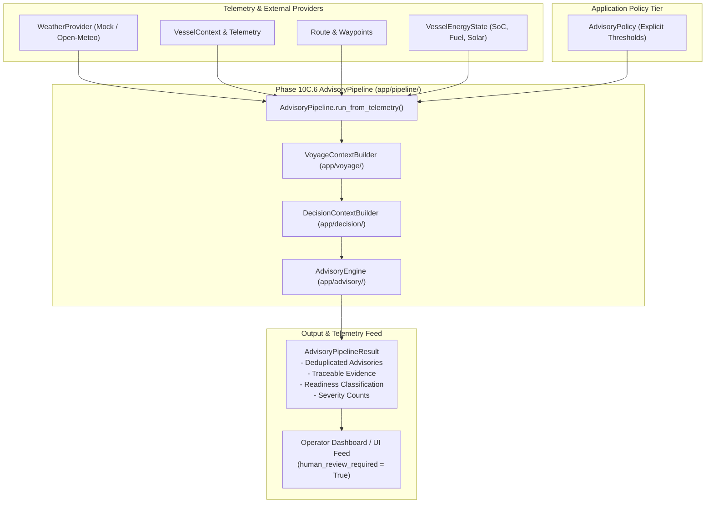

# PHASE 10C.6 — END-TO-END ADVISORY PIPELINE INTEGRATION & VALIDATION

**Document Version:** 1.0.0  
**Phase:** 10C.6 (Advisory Pipeline Integration Layer)  
**Status:** IMPLEMENTED / VERIFIED / READY FOR FREEZE  
**Target Module:** `app/pipeline/`  
**Test Suite:** `tests/test_advisory_pipeline.py`  

---

## 1. Executive Purpose & Scope

Phase 10C.6 delivers the end-to-end integration orchestrator connecting the entire application-layer decision-support foundation created across Phases 10C.1 through 10C.5.

> **Scope Declaration:**  
> Phase 10C.6 validates the end-to-end structured decision-support pipeline. It does **not** implement autonomous vessel control, wind-assisted propulsion, new engineering physics, or a user interface.

The pipeline executes purely as an integration orchestrator:
```text
Weather Provider (Phase 10C.1 / 10C.2)
       ↓
Normalized Weather Records (Phase 10C.1)
       ↓
Voyage Context (Phase 10C.3)
       ↓
Decision Context (Phase 10C.4)
       ↓
Advisory Engine (Phase 10C.5)
       ↓
AdvisoryPipelineResult (Phase 10C.6)
```

---

## 2. End-to-End Pipeline Architecture



---

## 3. Component Responsibilities

| Component | Module | Layer | Primary Responsibility |
|---|---|---|---|
| [`WeatherProvider`](file:///C:/maritime%20grids/app/weather/provider.py) | `app/weather/` | External Adapter | Standardized weather retrieval (current, route, historical, forecast). |
| [`VoyageContextBuilder`](file:///C:/maritime%20grids/app/voyage/context_builder.py) | `app/voyage/` | Context Aggregation | Assembles vessel parameters, waypoints, position, timeline, energy, and enriched weather. |
| [`DecisionContextBuilder`](file:///C:/maritime%20grids/app/decision/context_builder.py) | `app/decision/` | Decision Preparation | Validates inputs, links engineering calculations, and determines readiness state (`READY`, `STALE_DATA`, `INSUFFICIENT_DATA`, `INVALID_DATA`). |
| [`AdvisoryEngine`](file:///C:/maritime%20grids/app/advisory/engine.py) | `app/advisory/` | Rule Execution | Executes 9 deterministic rules against `DecisionContext` using explicit `AdvisoryPolicy`. |
| [`AdvisoryPipeline`](file:///C:/maritime%20grids/app/pipeline/advisory_pipeline.py) | `app/pipeline/` | Pipeline Orchestrator | Orchestrates end-to-end execution, tracks severity counts, and outputs structured results. |

---

## 4. Input / Output Contracts

### 4.1 Orchestrator Entry Points ([`app/pipeline/advisory_pipeline.py`](file:///C:/maritime%20grids/app/pipeline/advisory_pipeline.py))
* `run(context: DecisionContext, policy: Optional[AdvisoryPolicy]) -> AdvisoryPipelineResult`
* `run_from_voyage(voyage_context: VoyageContext, engineering_inputs, policy) -> AdvisoryPipelineResult`
* `run_from_telemetry(vessel, route, position, weather_provider, energy_state, ...) -> AdvisoryPipelineResult`

### 4.2 Output Schema ([`AdvisoryPipelineResult`](file:///C:/maritime%20grids/app/pipeline/advisory_pipeline.py#L42-L105))
* `pipeline_id: str` — Unique execution run identifier.
* `execution_timestamp_utc: str` — ISO 8601 UTC execution timestamp.
* `decision_context: DecisionContext` — Full snapshot of input and evaluated context.
* `policy_applied: Optional[AdvisoryPolicy]` — Applied operational policy parameters.
* `advisories: List[Advisory]` — Ordered, deduplicated actionable advisories.
* `readiness_state: AdvisoryReadinessState` — Overall context readiness rating.
* `total_advisories: int`, `critical_count: int`, `warning_count: int`, `notice_count: int`, `info_count: int` — Severity metrics.
* `to_summary_dict() -> Dict[str, Any]` — JSON-serializable representation for operator UI feeds.

---

## 5. Policy Handling & Absence of Silent Defaults

In strict compliance with Phase 10C.5 remediation:
1. **Explicit Policy Requirement:** The pipeline accepts an explicit [`AdvisoryPolicy`](file:///C:/maritime%20grids/app/advisory/contracts.py#L183-L191) containing `BatterySocPolicy`, `FuelLevelPolicy`, and `WeatherSafetyPolicy`.
2. **Zero Unconfigured Alarms:** If `policy` is omitted or contains `None` thresholds, all threshold-based rules remain inactive. No arbitrary or hard-coded constants (`35%`, `20%`, `1000 L`, `25 kts`, `2.5 m`) are ever applied.
3. **Evidence Integrity:** When an advisory is generated, the configured policy threshold is explicitly attached to `AdvisoryEvidence.threshold_value`.

---

## 6. Truthful Failure Propagation & Missing Data Semantics

Failure and data degradation states propagate truthfully through the pipeline without synthetic substitution:
* **Missing Weather (`None`):** `VoyageContext` marks weather quality as `UNAVAILABLE` $\rightarrow$ `DecisionContext` evaluates readiness as `INSUFFICIENT_DATA` $\rightarrow$ `AdvisoryEngine` emits `DataQualityWeatherUnavailableRule` and `DecisionReadinessRule` warnings.
* **Corrupt / Invalid Telemetry:** `NormalizedWeatherRecord` marks quality as `INVALID` $\rightarrow$ `DecisionContext` evaluates readiness as `INVALID_DATA` $\rightarrow$ `AdvisoryEngine` emits `DataQualityWeatherInvalidRule` (`CRITICAL`).
* **Stale / Expired Telemetry:** `freshness = EXPIRED` $\rightarrow$ `DecisionContext` evaluates readiness as `STALE_DATA` $\rightarrow$ `AdvisoryEngine` emits `DataQualityWeatherStaleRule` (`WARNING`).
* **Missing Energy Telemetry (`None`):** Missing battery or fuel values remain `None` and are never assumed to be zero (`missing != 0`).

---

## 7. Provenance Preservation

Every stage of the pipeline preserves the original metadata:
* `WeatherProvenanceType.OBSERVED` $\rightarrow$ Real-time station or sensor observations.
* `WeatherProvenanceType.HISTORICAL` $\rightarrow$ Reanalysis or archived records.
* `WeatherProvenanceType.FORECAST` $\rightarrow$ Numerical Weather Prediction (NWP) model outputs.
* `WeatherProvenanceType.SIMULATED` $\rightarrow$ Mathematical test fixtures.
* `WeatherProvenanceType.DERIVED` $\rightarrow$ Intermediate calculations.

---

## 8. Determinism & Deduplication

* **100% Deterministic:** Running identical inputs and policy produces identical advisory sets, severity rankings, and SHA-256 deduplication keys.
* **Deduplication:** Multiple rule firings sharing identical functional signatures are suppressed via `Advisory.deduplication_key`.
* **Bitwise Separation:** Distinction is strictly preserved between deterministic advisory content and execution run metadata (`pipeline_id`, `execution_timestamp_utc`).

---

## 9. Human-in-the-Loop Safety & Physical Boundaries

> [!CAUTION]
> **Safety Invariant:**  
> The pipeline strictly provides operator decision support.
> - `human_review_required` is unconditionally `True` on all generated advisories.
> - The integration module contains **zero** actuation, throttle adjustment, rudder steering, or equipment control APIs.
> - The pipeline never mutates routes, waypoints, vessel speed, course, or engine states.

```text
================================================================================
WIND PROPULSION & PHYSICS BOUNDARY AUDIT
================================================================================
Wind-assisted propulsion models: ABSENT
Engine-off calculations: ABSENT
Fuel savings from wind: ABSENT
Autonomous vessel actuation: ABSENT
================================================================================
```

---

## 10. Dedicated Integration Tests

Implemented in [`tests/test_advisory_pipeline.py`](file:///C:/maritime%20grids/tests/test_advisory_pipeline.py) (25 deterministic offline integration tests):

* **Scenarios 1–6 (Basic Flow):** Valid telemetry $\rightarrow$ valid context $\rightarrow$ 0 alarms on healthy state $\rightarrow$ configured battery/fuel/wind/wave advisories.
* **Scenarios 7–11 (Weather & Data Quality):** Stale weather, unavailable weather, invalid weather (`CRITICAL`), historical and forecast provenance preservation.
* **Scenarios 12–15 (Policy & Determinism):** Zero unconfigured false alarms, policy sensitivity, evidence threshold values, repeatable execution determinism.
* **Scenarios 16–20 (Safety & Physical Bounds):** `human_review_required = True`, no route mutation, no speed mutation, no engine-off calculations, no wind propulsion models.
* **Scenarios 21–25 (Metrics & Telemetry Feed):** Severity counts, `to_summary_dict()` JSON serialization, CII compliance, missing energy telemetry propagation, offline execution.

---

## 11. Regression Suite Results

* **Phase 10C.6 Integration Pipeline Tests:** `25 / 25 PASS`
* **Phase 10C.5 Advisory Engine Tests:** `45 / 45 PASS`
* **Phase 10C.4 Decision Context Tests:** `25 / 25 PASS`
* **Phase 10C.3 Voyage Context Tests:** `24 / 24 PASS`
* **Phase 10C.2 Open-Meteo Provider Tests:** `23 / 23 PASS`
* **Phase 10C.1 Weather Foundation Tests:** `20 / 20 PASS`
* **Phase 10A Facade Tests:** `16 / 16 PASS`
* **Phase 0–9 Core Engineering Regression:** `481 / 481 PASS`
* **Total Combined Regression Suite:** **`659 / 659 PASS`** (Python 3.14.7)

---

## 12. Frozen Artifact & Dataset Integrity

| Artifact | Canonical SHA-256 Hash | Status |
|---|---|---|
| `models/weather_final.joblib` | `39b08a4ba2c860dc74a094f8ad460b3aaa001a9d1b212717baadce55cfc1e6a3` | **MATCH (VERIFIED)** |
| `models/fuel_xgb.joblib` | `cb6a4e0922b0b0919583ca453568960a2b6495f321d43cff0aab299a4aaf8323` | **MATCH (VERIFIED)** |
| `models/battery_soh_final.joblib` | `9611e0507b8bf840d31d0be3b1223ff2368ae6da93e89fca351aea7fc7420eb1` | **MATCH (VERIFIED)** |
| `models/battery_soc_lstm.pt` | `c2077e5111648234d7e3b3cc9b2944f1db95c1e6fedc1ea96fd0514e1f35ad25` | **MATCH (VERIFIED)** |
| `data/reference/ship_profiles.csv` | `0f2040a481790b034fac11cd9e2b628c725281397610fe0bdba09f6feed7de75` | **MATCH (VERIFIED)** |
| `data/raw/` raw dataset files | **6,228 files** | **EXACT COUNT (VERIFIED)** |

---

## 13. Known Limitations & Dashboard Demarcation

* **No User Interface:** Phase 10C.6 provides structured JSON/Python objects only. Visual rendering, web frontend, and CLI formatting belong to subsequent phases.
* **No Autonomous Actuation:** Advisories require captain/operator review.
* **Environmental Context Only:** Wind and waves provide drag and safety context, not propulsive energy.

---

## 14. Final Status Declaration

```text
================================================================================
PHASE 10C.6 — IMPLEMENTED / VERIFIED / READY FOR FREEZE
================================================================================
```
