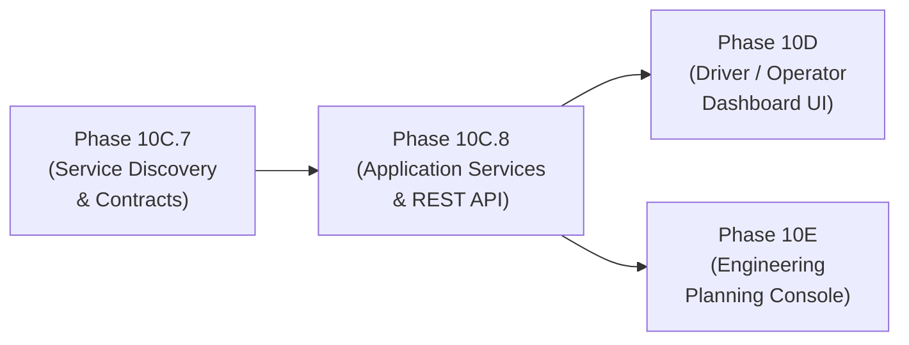

# PHASE 10C.7 — APPLICATION SERVICE BOUNDARY & OPERATOR-FACING API CONTRACT DISCOVERY

**Document Version:** 1.0.0  
**Phase:** 10C.7 (Application Service Boundary & Contract Discovery)  
**Status:** DISCOVERY COMPLETE / READY FOR IMPLEMENTATION  
**Project Root:** `C:\maritime grids`  

---

## 1. Executive Summary

Phase 10C.7 establishes the architectural boundary and formal API/service contracts between the computational backend (Phases 0–10C.6) and future user-facing presentation layers (Driver/Operator Dashboard, Engineering/Planning Console, REST/WebSocket transport).

> **Architectural Boundary Invariant:**  
> Phase 10C.7 is a **read-only discovery and contract design phase**. It defines service interfaces, field mappings, data availability, and safety requirements. It does **not** implement UI frontend components, web servers, WebSockets, databases, authentication, autonomous actuation, or new engineering physics.

### Core Architectural Principle:
```text
                          APPLICATION LAYER
                                  │
                 ┌────────────────┴────────────────┐
                 ↓                                 ↓
      ENGINEERING / PLANNING               OPERATOR / DRIVER
        (Long-Horizon / Sizing)           (Real-Time / Situational)
                 │                                 │
                 └────────────────┬────────────────┘
                                  ↓
                       APPLICATION SERVICES
                                  ↓
                       EXISTING FACADE / CORE
                                  ↓
                     Weather / Voyage / Decision
                                  ↓
                              Advisory
```
The application service acts strictly as an **adapter and orchestrator**. It never functions as a secondary physics or numerical calculation engine.

---

## 2. Current Architecture & Verified Baseline

### 2.1 Regression Baseline
* Phase 0–9 Core Regression: `481 / 481 PASS`
* Phase 10A Integration Facade: `16 / 16 PASS`
* Phase 10C.1 Weather Foundation: `20 / 20 PASS`
* Phase 10C.2 Open-Meteo Provider: `23 / 23 PASS`
* Phase 10C.3 Voyage Context: `24 / 24 PASS`
* Phase 10C.4 Decision Context: `25 / 25 PASS`
* Phase 10C.5 Advisory Engine & Provenance: `45 / 45 PASS`
* Phase 10C.6 End-to-End Advisory Pipeline: `25 / 25 PASS`
* **Total Current Regression Suite:** **`659 / 659 PASS`** (Python 3.14.7)

### 2.2 Canonical Frozen Artifacts
All canonical SHA-256 hashes and raw datasets remain 100% bit-identical:
* `models/weather_final.joblib`: `39b08a4ba2c860dc74a094f8ad460b3aaa001a9d1b212717baadce55cfc1e6a3`
* `models/fuel_xgb.joblib`: `cb6a4e0922b0b0919583ca453568960a2b6495f321d43cff0aab299a4aaf8323`
* `models/battery_soh_final.joblib`: `9611e0507b8bf840d31d0be3b1223ff2368ae6da93e89fca351aea7fc7420eb1`
* `models/battery_soc_lstm.pt`: `c2077e5111648234d7e3b3cc9b2944f1db95c1e6fedc1ea96fd0514e1f35ad25`
* `data/reference/ship_profiles.csv`: `0f2040a481790b034fac11cd9e2b628c725281397610fe0bdba09f6feed7de75`
* `data/raw/` raw dataset files: **6,228 files**

---

## 3. Existing Public Interfaces

The application service layer connects to verified components through standardized public interfaces:

| Component | Location | Primary Contract / Interface |
|---|---|---|
| [`WeatherProvider`](file:///C:/maritime%20grids/app/weather/provider.py) | `app/weather/` | `get_current_weather()`, `get_historical_weather()`, `get_forecast_weather()`, `get_route_weather()` |
| [`NormalizedWeatherRecord`](file:///C:/maritime%20grids/app/weather/contracts.py) | `app/weather/` | Schema for physical atmospheric & oceanographic fields with provenance & quality |
| [`VoyageContextBuilder`](file:///C:/maritime%20grids/app/voyage/context_builder.py) | `app/voyage/` | Builder for `VoyageContext` (vessel, route, position, timeline, weather, energy) |
| [`DecisionContextBuilder`](file:///C:/maritime%20grids/app/decision/context_builder.py) | `app/decision/` | Builder for `DecisionContext` computing `AdvisoryReadinessState` |
| [`AdvisoryPolicy`](file:///C:/maritime%20grids/app/advisory/contracts.py) | `app/advisory/` | Strongly-typed policy thresholds (`BatterySocPolicy`, `FuelLevelPolicy`, `WeatherSafetyPolicy`) |
| [`AdvisoryEngine`](file:///C:/maritime%20grids/app/advisory/engine.py) | `app/advisory/` | Deterministic rule evaluator with deduplication & severity sorting |
| [`AdvisoryPipeline`](file:///C:/maritime%20grids/app/pipeline/advisory_pipeline.py) | `app/pipeline/` | Orchestrator returning `AdvisoryPipelineResult` |
| [`MaritimeScenarioFacade`](file:///C:/maritime%20grids/app/facade/scenario_facade.py) | `app/facade/` | High-level adapter into frozen Phase 6–9 engineering & optimization core |

---

## 4. Engineering / Planning Service Contract

The Engineering / Planning Service provides long-horizon simulation, design sizing, techno-economic analysis, multi-year regulatory trajectory, and scenario dossier generation.

### Mapping to Existing Facade Operations:

| Application Capability | Existing Facade Operation | Underlying Phase | Status |
|---|---|---|---|
| **Voyage Simulation** | `simulate_voyage(SimulateVoyageRequest)` | Phase 6 Gateway | **EXISTING** |
| **Sizing Evaluation** | `evaluate_sizing_candidate(EvaluateSizingCandidateRequest)` | Phase 8 Optimizer | **EXISTING** |
| **System Sizing Optimization** | `optimize_system_sizing(OptimizeSystemSizingRequest)` | Phase 8 Optimizer | **EXISTING** |
| **Sensitivity Analysis** | `run_sensitivity_analysis(SensitivityAnalysisRequest)` | Phase 9 Candidate 1 | **EXISTING** |
| **Break-Even Analysis** | `run_break_even_analysis(BreakEvenAnalysisRequest)` | Phase 9 Candidate 1 | **EXISTING** |
| **2D Grid Parameter Sweep** | `run_2d_grid_analysis(Grid2DAnalysisRequest)` | Phase 9 Candidate 1 | **EXISTING** |
| **Speed & Sizing Co-Optimization** | `optimize_speed_and_sizing(SpeedCoOptimizationFacadeRequest)` | Phase 9 Candidate 2 | **EXISTING** |
| **Fleet Decarbonization Portfolio** | `optimize_fleet_portfolio(PortfolioOptimizationFacadeRequest)` | Phase 9 Candidate 3 | **EXISTING** |
| **Multi-Year CII Trajectory** | `simulate_cii_trajectory(CIIComplianceTrajectoryRequest)` | Phase 9 Candidate 4 | **EXISTING** |
| **Scenario Dossier Export** | `export_scenario_dossier(DossierExportFacadeRequest)` | Phase 9 Candidate 5 | **EXISTING** |

---

## 5. Operator / Driver Service Contract

The Operator / Driver Service provides real-time situational awareness, voyage tracking, instantaneous energy balances, weather risk evaluation, and human-in-the-loop decision-support advisories.

### 5.1 Permitted Capabilities:
* Current vessel positioning and navigation telemetry monitoring.
* Route progress, waypoint sequencing, and distance-to-go calculations.
* Real-time and forecasted environmental conditions along the route.
* Instantaneous battery SoC, fuel remaining, and solar generation telemetry.
* Attained IMO Carbon Intensity Indicator (CII) tracking.
* Deterministic operational advisories with verifiable evidence and recommended mitigation.
* Sensor data quality and telemetry freshness warnings.

### 5.2 Strict Prohibition on Autonomy & Actuation:
> [!CAUTION]
> The Operator Service must **NEVER** expose APIs, endpoints, or background threads that perform:
> - Throttle manipulation or engine power commands.
> - Rudder control or steering actuation.
> - Engine start / stop commands.
> - Autonomous waypoint alteration or speed changes.
> - Direct equipment or breaker switching.
>
> All generated advisories must have `human_review_required = True`.

---

## 6. Live vs Historical vs Forecast Semantics

Every telemetry and weather record exposed to the application must strictly distinguish its temporal and methodological provenance:

| Provenance Enum | Definition | Application Handling |
|---|---|---|
| `OBSERVED` | Direct instantaneous physical measurement (AIS, on-board sensors, station observation). | Treated as real-time ground truth. Monitored for freshness age. |
| `HISTORICAL` | Reanalysis or archived record corresponding to a past timestamp. | Used for historical voyage replays and retrospective baselining. Never presented as live current conditions. |
| `FORECAST` | Forward-looking Numerical Weather Prediction (NWP) model output. | Used for waypoint lookaheads and route planning. Explicitly tagged with forecast valid time. |
| `MODEL_PREDICTION` | Output generated by frozen ML models (Fuel XGBoost, Battery SOH Random Forest, Battery SoC LSTM). | Clearly attributed to model inference with associated inputs. |
| `SIMULATED` | Deterministic synthetic test fixture or mathematical simulation. | Used in test suites and offline scenarios. Never masqueraded as real telemetry. |
| `UNAVAILABLE` | Telemetry was requested but is missing or inaccessible. | Explicitly preserved as `None` / `UNAVAILABLE`. Never substituted with zero or fake values. |

### Weather Field Specification:
For every weather telemetry field:
* **Value & Unit:** e.g., `wind_speed_knots` (`knots`), `wave_height_m` (`meters`), `temperature_c` (`°C`), `daily_ghi_kwh_per_m2` (`kWh/m²`).
* **Source / Provider:** e.g., `"Open-Meteo"`, `"MOCK_DETERMINISTIC"`, `"Onboard Anemometer"`.
* **Timestamp:** ISO 8601 UTC timestamp of validity.
* **Provenance:** `WeatherProvenanceType` enum (`OBSERVED`, `HISTORICAL`, `FORECAST`, `SIMULATED`).
* **Quality:** `WeatherQualityState` enum (`VALID`, `PARTIAL`, `INVALID`, `UNAVAILABLE`).
* **Freshness:** `WeatherFreshnessState` enum (`FRESH`, `STALE`, `EXPIRED`, `UNKNOWN`) with `freshness_age_seconds`.

---

## 7. Data Quality Contract

The service boundary defines explicit application behavior for all data quality states:

| Quality State | Backend Condition | Service Response Representation |
|---|---|---|
| `VALID` | All mandatory fields within physical bounds and fresh. | Standard response; `readiness = READY`; zero data quality advisories. |
| `PARTIAL` | Optional fields missing (e.g. wave period None). | Standard response with explicit `None` fields; `readiness = PARTIAL`; non-blocking notice if relevant. |
| `STALE` | Telemetry age exceeds fresh threshold (e.g. >3 hours). | Data returned with `freshness = STALE` / `EXPIRED`; `readiness = STALE_DATA`; `DataQualityWeatherStaleRule` advisory emitted. |
| `INVALID` | Field violates physical bounds (e.g. humidity >100%, negative wave height). | Corrupted fields rejected; `readiness = INVALID_DATA`; `DataQualityWeatherInvalidRule` (`CRITICAL`) emitted. |
| `UNAVAILABLE`| Data source unreachable or no telemetry received. | Fields returned as `None`; `readiness = INSUFFICIENT_DATA`; `DataQualityWeatherUnavailableRule` emitted. |

### Architectural Representation Choice:
Data quality is represented through a **hybrid status + advisory approach**:
1. **Response Metadata:** `readiness_state` (`READY`, `PARTIAL`, `STALE_DATA`, `INSUFFICIENT_DATA`, `INVALID_DATA`) and `readiness_reasons`.
2. **Field-Level Nullability:** Missing fields remain explicit `None` (truthful reporting, zero fake fallbacks).
3. **Structured Advisories:** Generated `Advisory` items with `AdvisoryCategory.DATA_QUALITY` and traceable `AdvisoryEvidence` detailing the exact corrupted or missing source field.

---

## 8. Conceptual Operator Response Contract & Field Availability Matrix

### 8.1 Conceptual Schema (`OperatorStateResponse`)
```yaml
OperatorStateResponse:
  metadata:
    request_id: str
    generated_at_utc: str
    overall_readiness: AdvisoryReadinessState
    readiness_reasons: List[str]
  vessel:
    vessel_id: str
    ship_type: str
    current_position: VesselPosition
    route: Route
    route_progress_pct: Optional[float]
    distance_remaining_nm: Optional[float]
    eta_utc: Optional[str]
  weather:
    current: Optional[NormalizedWeatherRecord]
    route_profile: Optional[RouteWeatherProfile]
  energy:
    battery_soc_pct: Optional[float]
    battery_soh_pct: Optional[float]
    fuel_remaining_liters: Optional[float]
    fuel_consumption_rate_lph: Optional[float]
    solar_power_kw: Optional[float]
    solar_energy_today_kwh: Optional[float]
  regulatory:
    attained_cii_rating: Optional[str]
    required_cii_value: Optional[float]
    compliance_state: Optional[str]
  advisories:
    total_count: int
    critical_count: int
    warning_count: int
    items: List[Advisory]
```

### 8.2 Mandatory Field Availability Matrix:

| Category | Field | Classification | Backend Contract Source |
|---|---|---|---|
| **Metadata** | `request_id` | **EXISTS** | `AdvisoryPipelineResult.pipeline_id` |
| | `generated_at_utc` | **EXISTS** | `AdvisoryPipelineResult.execution_timestamp_utc` |
| | `overall_readiness` | **EXISTS** | `DecisionContext.readiness` |
| | `readiness_reasons` | **EXISTS** | `DecisionContext.readiness_reasons` |
| **Vessel** | `vessel_id` | **EXISTS** | `VesselContext.vessel_id` |
| | `ship_type` | **EXISTS** | `VesselContext.ship_type` |
| | `current_position` | **EXISTS** | `VesselPosition` (`latitude`, `longitude`, `sog`, `cog`, `ts`) |
| | `route` | **EXISTS** | `Route` (`route_id`, `waypoints`, `total_distance_nm`) |
| | `route_progress_pct` | **DERIVABLE FROM EXISTING CONTRACT** | Calculated from `current_position` vs waypoint distance |
| | `distance_remaining_nm` | **DERIVABLE FROM EXISTING CONTRACT** | Waypoint remaining distance summation |
| | `eta_utc` | **DERIVABLE FROM EXISTING CONTRACT** | `distance_remaining_nm / speed_over_ground_knots` |
| **Weather** | `current` (wind, wave, temp, etc.) | **EXISTS** | `VoyageWeatherContext.current_weather` |
| | `route_profile` | **EXISTS** | `VoyageWeatherContext.route_weather` |
| **Energy** | `battery_soc_pct` | **EXISTS** | `VesselEnergyState.battery_soc_pct` |
| | `battery_soh_pct` | **EXISTS** | `VesselEnergyState.battery_soh_pct` |
| | `fuel_remaining_liters` | **EXISTS** | `VesselEnergyState.fuel_remaining_liters` |
| | `fuel_consumption_rate_lph`| **EXISTS** | `VesselEnergyState.fuel_consumption_rate_lph` |
| | `solar_power_kw` | **EXISTS** | `VesselEnergyState.solar_power_kw` |
| | `solar_energy_today_kwh` | **EXISTS** | `VesselEnergyState.solar_energy_today_kwh` |
| **Regulatory** | `attained_cii_rating` | **EXISTS** | `EngineeringDecisionInputs.cii_attained_rating` |
| | `required_cii_value` | **EXISTS** | `Phase6SimulationResult.cii_reference` |
| | `compliance_state` | **DERIVABLE FROM EXISTING CONTRACT** | Derived from CII rating (`A-C: Compliant`, `D-E: Non-Compliant`) |
| **Advisories**| `items` (advisories + evidence)| **EXISTS** | `AdvisoryPipelineResult.advisories` |
| | `critical_count` / `warning_count`| **EXISTS** | `AdvisoryPipelineResult.critical_count` / `warning_count` |
| **Application**| `authenticated_user` | **REQUIRES NEW INPUT** | Future Auth / User Session Module |
| | `alert_acknowledgement` | **NOT CURRENTLY AVAILABLE** | Future Interactive UI State Store |
| | `advisory_history` | **NOT CURRENTLY AVAILABLE** | Future Persistence / DB Layer |

---

## 9. Advisory Contract & Traceability Schema

All advisories exposed via the service layer preserve the canonical Phase 10C.5 contract:
* `advisory_id: str` — Unique identifier.
* `rule_id: str` — Triggering rule identifier (`ENG_BATT_SOC_001`, `MET_WIND_HIGH_001`, etc.).
* `category: AdvisoryCategory` — `WEATHER`, `BATTERY`, `FUEL`, `CII`, `DATA_QUALITY`, `SYSTEM`.
* `severity: AdvisorySeverity` — `CRITICAL`, `WARNING`, `NOTICE`, `INFO`.
* `title: str` / `message: str` — Human-readable headline and operational explanation.
* `status: AdvisoryStatus` — `ACTIVE`, `EXPIRED`, `SUPPRESSED`, `INVALID`.
* `created_at_utc: str` / `valid_until_utc: Optional[str]` — Normalized UTC validity window.
* `human_review_required: bool` — **Always `True`**.
* `deduplication_key: str` — Deterministic hash for active notification deduplication.
* `evidence: List[AdvisoryEvidence]` — Traceable record containing:
  - `source_field: str`
  - `observed_value: Any`
  - `threshold_value: Optional[Any]` (policy threshold)
  - `provenance: WeatherProvenanceType`
  - `quality: WeatherQualityState`
  - `freshness: WeatherFreshnessState`
  - `timestamp_utc: str`

---

## 10. Dashboard Readiness Evaluation

### 10.1 Driver / Operator Dashboard Readiness:

| UI Panel / Widget | Backend Readiness | Concrete Justification |
|---|---|---|
| **Live Map & Waypoints** | **READY** | Supported by `VesselPosition`, `Route`, `RouteWaypoint`, and `RouteWeatherProfile`. |
| **Weather Panel** | **READY** | Supported by `NormalizedWeatherRecord` (wind, waves, temperature, pressure, solar GHI). |
| **Fuel Reserve Panel** | **READY** | Supported by `VesselEnergyState` (`fuel_remaining_liters`, `fuel_consumption_rate_lph`). |
| **Battery SoC/SOH Panel**| **READY** | Supported by `VesselEnergyState` (`battery_soc_pct`, `battery_soh_pct`, `battery_energy_available_kwh`). |
| **Solar Generation Panel**| **READY** | Supported by `VesselEnergyState` (`solar_power_kw`, `solar_energy_today_kwh`, `daily_ghi_kwh_per_m2`). |
| **Speed & Navigation Panel**| **READY** | Supported by `VesselPosition` (`speed_over_ground_knots`, `course_over_ground_deg`). |
| **CII Regulatory Panel** | **READY** | Supported by `EngineeringDecisionInputs` (`cii_attained_rating`, `co2_emissions_kg`). |
| **Advisory & Alerts Panel**| **READY** | Supported by `AdvisoryPipelineResult.advisories` with severity sorting & evidence. |
| **Data Quality Panel** | **READY** | Supported by `AdvisoryReadinessState`, `WeatherQualityState`, and freshness metrics. |

### 10.2 Engineering / Planning Dashboard Readiness:

| Planning Workflow | Backend Readiness | Facade Operation |
|---|---|---|
| **Scenario Input** | **READY** | `SimulateVoyageRequest`, `OptimizationParameters` |
| **Voyage Simulation** | **READY** | `MaritimeScenarioFacade.simulate_voyage()` |
| **Sizing Evaluation** | **READY** | `MaritimeScenarioFacade.evaluate_sizing_candidate()` |
| **Parametric Sizing Optimization** | **READY** | `MaritimeScenarioFacade.optimize_system_sizing()` |
| **Sensitivity Analysis** | **READY** | `MaritimeScenarioFacade.run_sensitivity_analysis()` |
| **Speed Co-Optimization** | **READY** | `MaritimeScenarioFacade.optimize_speed_and_sizing()` |
| **Fleet Portfolio Allocation** | **READY** | `MaritimeScenarioFacade.optimize_fleet_portfolio()` |
| **CII Trajectory Simulation** | **READY** | `MaritimeScenarioFacade.simulate_cii_trajectory()` |
| **Techno-Economic Analysis** | **READY** | `phase7_economics` integration via Phase 8/9 |
| **Scenario Dossier Export** | **READY** | `MaritimeScenarioFacade.export_scenario_dossier()` |

---

## 11. Application Layer Gaps (Transport & Persistence)

The computational backend and context models are complete. The following infrastructure capabilities represent application/transport gaps that must be implemented in subsequent phases:

| Required Capability | Existing | Partial | Missing | Concrete Architectural Evidence |
|---|---|---|---|---|
| **Computational Core & Pipeline** | **YES** | — | — | Phases 0–10C.6 fully verified (`659/659 PASS`). |
| **Context & Advisory Contracts** | **YES** | — | — | `app/weather`, `app/voyage`, `app/decision`, `app/advisory`, `app/pipeline`. |
| **Live Telemetry Ingestion API** | — | **PARTIAL** | — | `AdvisoryPipeline.run_from_telemetry()` exists; HTTP/REST receiver endpoint missing. |
| **Persistent Voyage State Store** | — | — | **MISSING** | In-memory only; no SQLite/PostgreSQL persistence for live voyages. |
| **Real-Time WebSocket Transport** | — | — | **MISSING** | No WebSocket server or pub/sub push layer currently implemented. |
| **Alert Acknowledgement Store** | — | — | **MISSING** | `AdvisoryStatus` exists (`ACTIVE`, `SUPPRESSED`), but no operator ack persistence store. |
| **Historical Advisory Audit Log** | — | — | **MISSING** | No time-series audit database for past advisories. |
| **User Authentication & RBAC** | — | — | **MISSING** | No JWT / session auth layer for Captain vs Chief Engineer vs Fleet Manager roles. |
| **REST API Server (FastAPI)** | — | — | **MISSING** | Service schemas defined in discovery; FastAPI/Starlette app not yet instantiated. |

---

## 12. Security & Safety Requirements

Future service implementation must satisfy the following non-negotiable security requirements:
1. **Input Validation:** All incoming HTTP/JSON payloads must be validated strictly through Pydantic V2 schemas before being passed to context builders.
2. **Zero Dynamic Execution:** Strict prohibition of `eval()`, `exec()`, or dynamic module loading.
3. **Safe Model Ingestion:** ML model artifacts must remain frozen and loaded strictly via verified file paths (`joblib.load`, `torch.load` with weights_only=True where applicable).
4. **Path Traversal Protection:** Dossier export paths and file persistence must be sanitized against directory traversal (`..`).
5. **No Network Leaks in Computational Core:** Computational calculations remain 100% offline; network calls restricted strictly to configured external weather providers.

---

## 13. Human-in-the-Loop & Physical Boundary Audit

### 13.1 Autonomous Control Audit:
```text
================================================================================
AUTONOMOUS CONTROL AUDIT
================================================================================
Throttle actuation APIs: ABSENT
Rudder / steering APIs: ABSENT
Engine start / stop commands: ABSENT
Autonomous route altering: ABSENT
Equipment switching commands: ABSENT
Control loops: ABSENT
================================================================================
Conclusion: 100% Human-in-the-Loop. human_review_required is unconditionally True.
================================================================================
```

### 13.2 Wind Propulsion Capability Audit:
```text
================================================================================
WIND PROPULSION CAPABILITY GAP — NOT IMPLEMENTED
================================================================================
Sail thrust models: ABSENT
Flettner rotor models: ABSENT
Kite propulsion models: ABSENT
Aerodynamic forward thrust: ABSENT
Wind-derived fuel savings: ABSENT
Engine-off duration calculations: ABSENT
================================================================================
Conclusion: Environmental wind telemetry provides aerodynamic drag context only.
================================================================================
```

---

## 14. Threshold Provenance Audit

Confirmed across all application layers:
* **Zero Hard-Coded Defaults:** `BatterySocPolicy`, `FuelLevelPolicy`, and `WeatherSafetyPolicy` default strictly to `None`.
* **No Unprompted Alarms:** If a caller does not configure a threshold, the system emits zero false alarms.
* **No Reintroduced Constants:** The values `20%`, `35%`, `1000 L`, `25 knots`, `2.5 m` exist solely as caller-supplied policy parameters and never as silent defaults.

---

## 15. Recommended Implementation Sequence



1. **Phase 10C.7 (Current):** Read-only architecture discovery and API contract definition (**COMPLETE**).
2. **Phase 10C.8:** Implement `app/services/` (OperatorService, EngineeringService) and lightweight REST endpoints (FastAPI) wrapping existing facade and pipeline.
3. **Phase 10D:** Implement the real-time Driver/Operator Dashboard frontend.
4. **Phase 10E:** Implement the Engineering/Planning Web Console and reporting UI.

---

## 16. Mandatory Self-Audit

| Audit Item | Question | Verification Response |
|---|---|---|
| **Architecture** | Did this phase avoid duplicating existing application logic? | **YES.** Orchestrates existing facade, weather, voyage, decision, advisory layers. |
| **Facade Boundary** | Was the facade boundary preserved without modification? | **YES.** `MaritimeScenarioFacade` and frozen Phase 0–9 core remain untouched. |
| **Operator Safety** | Is the system strictly human-in-the-loop? | **YES.** Zero actuation or autonomous control APIs exist. |
| **Data Semantics** | Are `OBSERVED`, `HISTORICAL`, `FORECAST`, `SIMULATED`, and `UNAVAILABLE` distinguishable? | **YES.** Explicit enum states and field nullability enforced. |
| **Threshold Provenance** | Were any unauthorized numerical thresholds introduced? | **NO.** Pure policy configuration with `None` defaults maintained. |
| **Physical Capability** | Was wind propulsion or engine-off calculation introduced? | **NO.** Re-verified as strictly absent. |
| **Regression Suite** | Does the full regression pass? | **YES.** `659 / 659 PASS`. |
| **Artifact Integrity** | Are canonical model hashes and raw dataset counts intact? | **YES.** 5/5 hashes matched; 6,228 raw files verified. |

---

## 17. Final Status Declaration

```text
================================================================================
PHASE 10C.7 — DISCOVERY COMPLETE / READY FOR IMPLEMENTATION
================================================================================
```
